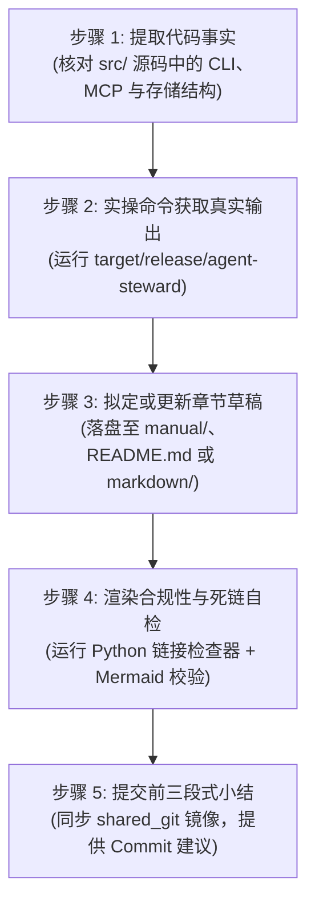

# Agent Host Steward 文档编写与手册迭代技能 (agent-steward-doc-writer)

> **定位**: 本技能驻留在 `agent-steward` 项目内部（`skills/agent-steward-doc-writer/SKILL.md`），是指导任何接手该项目的 AI Agent（无论是主 Agent 还是文档 Subagent）高保真、可复现、接地气地编写与迭代项目根目录 `README.md`、`manual/` 分卷技术手册与 `markdown/` 对外深度长文的操作指南。

---

## 一、核心原则与写作戒律（红线）

写技术文档不是堆砌名词，更不是凭空编造。编写本项目的任何文档，必须严格遵守以下 **六大铁律**：

1. **代码真实性第一（Zero Hallucination）**：
   - 所有的命令参数、子命令名称、配置项键名、MCP 工具名称（共 40 个）、JSON 返回结构，必须直接源自 `src/` 源码（如 `src/main.rs`, `src/api/mcp_tools.rs`, `src/config/mod.rs`, `src/links/`），绝不允许擅自发明不存在的命令或参数。
   - 凡涉及运行依赖、环境要求与部署配置，必须严格注明**“必选 (Required)”**与**“可选 (Optional)”**，并在 [INSTALL.md](../../INSTALL.md) 与 [config.example.toml](../../config.example.toml) 中保持事实对齐。
2. **命令必须实跑验证（Execution-Verified）**：
   - 文档中凡是贴出的 CLI 输出、curl 返回或 JSON 示例，**必须使用编译出来的实际二进制执行一次**（例如 `./target/release/agent-steward env port 22`、`./target/release/agent-steward links audit`），捕获真实输出后贴入，严禁“凭印象编造输出”。
3. **通俗易懂与直击痛点（小白听得懂，架构师有共鸣）**：
   - 开篇不讲枯燥概念，先讲**场景痛点**（“为什么 Agent 换了个会话就乱放文件？”、“为什么启动测试服务会把宿主机端口打架打崩？”、“改动一个公共脚本怎么知道下游哪几个 cron 会挂？”）；
   - 用大白话类比解释核心机制（例如：黑名单浅层阻断 = “敲门但不进屋”，防止把 node_modules 万级无用碎片扫爆数据库；宏微双层联邦 = “大管家管城市交通网，CodeGraph 管大楼内部房间”）。
4. **全套结构化排版与防渲染踩坑**：
   - 代码块标注具体语言（`bash`, `json`, `toml`, `sql`）；
   - 所有 Mermaid 图必须使用标准语法（节点文字含特殊符号或括号必须用双引号包裹，如 `node["描述 (详情)"]`），布局美观，避免文字重叠或溢出；
   - 矢量图解必须先落盘为独立 SVG 文件（统一置于 `markdown/svg/`），在 Markdown 中使用标准图片语法引用对应 SVG 路径；
   - 全局相对链接与文件引用必须 100% 真实有效，严禁出现断链或死链。
5. **双轮驱动同步机制**：
   - 任何核心特性的发布或调整，必须同步检查：
     - **根目录 `README.md`**：保持项目门面最新（架构全景、核心定位、快速上手、MCP 配置简明指南、分阶段路线索引）；
     - **`manual/` 目录**：保持深度分卷手册完备（01~07 章节化深度展开、排障常见问题、参数字典）；
     - **`markdown/` 目录**：提炼适合对外技术传播的长文与高保真图解。
6. **断点式增量推进**：
   - 当需要重构或批量撰写 `manual/` 多章节长手册时，必须在 [manual/README.md](../../manual/README.md) 中维护章节目录进度清单，按章节串行步进。

---

## 二、文档目标受众与手册目录体系架构

### 2.1 读者画像
1. **AI Agent 本身**：通过阅读 `README.md` 和 `manual/04-mcp-integration.md`，知道如何通过 stdio MCP 挂载大管家，在开工时主动调用 `steward_brief`。
2. **普通开发者与工程师**：希望能一条命令安装并作为后台守护进程跑起来，规范本地文件和记忆。
3. **系统架构师与平台运维**：关心安全隐私（数据是否全部本地 SQLite）、资源消耗（守护进程常驻仅 2.1MB 内存）、分级扫描黑名单阻断、端口防撞以及宏微代码拓扑穿透机制。

### 2.2 `manual/` 目录落地的标准分卷体系
`manual/` 目录下已建立规范的 9 卷技术手册体系：

```
manual/
├── README.md                      # 手册全景导航、章节说明与阅读路线
├── 01-getting-started.md          # 快速上手与编译部署
├── 02-core-concepts.md            # 核心理念与设计哲学（三位一体与分级扫描）
├── 03-cli-reference.md            # 全量 CLI 命令行实战字典
├── 04-mcp-integration.md          # Agent 接入与 MCP 协议指南（39 个原生工具）
├── 05-daemon-and-watcher.md       # 守护进程与 inotify 实时监听
├── 06-advanced-features.md        # 进阶特性指南（断链修复、GC、记忆生命周期、TUI）
├── 07-troubleshooting.md          # 故障诊断与常见问题 (FAQ)
├── 08-web-dashboard.md            # Web UI 2.0 昼夜蓝图、拓扑大屏与路演剧场
└── 09-hooks-integration.md        # HOOK 驱动集成引擎与 Pipeline 编排
```

---

## 三、文档编写与迭代五步工作流



### 步骤 1: 提取代码事实
在动笔前，Agent 必须快速查阅：
- `src/main.rs`：当前支持的所有子命令与 flags 参数；
- `src/api/mcp_tools.rs`：当前注册的全部 **39 个原生 MCP 工具** 名与 inputSchema；
- `src/config/mod.rs`：当前的 `config.toml` 配置项结构体；
- `src/storage/schema.sql`：预置的 8 大放置规则与 10 大扫描策略；
- `src/links/`：依赖关系解析引擎、断链体检规则与 CodeGraph 穿透接口。

### 步骤 2: 实操命令获取真实输出
针对文档中需要出现的示例，在终端中以 release 二进制执行捕获：
```bash
./target/release/agent-steward place suggest --type script --name demo_tool --intent "数据抓取"
./target/release/agent-steward env port 22
./target/release/agent-steward links audit
./target/release/agent-steward links impact /root/new/shared_proj/demo.py
./target/release/agent-steward codegraph bridge --query "init"
```
将真实返回结果原汁原味地嵌入文档代码块中。

### 步骤 3: 结构化撰写规范
每个命令或工具的介绍必须遵循 **四段式结构**：
1. **这是什么（一句话大白话直击核心）**；
2. **为什么需要它（解决什么痛点、不用的严重后果）**；
3. **真实调用示例与参数说明（含 CLI 与 MCP 对应方法）**；
4. **实际返回输出与结果解读**。

### 步骤 4: Markdown、SVG 与死链自检
- **代码块语法声明**：严格区分 `bash`、`json`、`toml`、`sql`；
- **Mermaid 括号转义**：
  - 错误写法: `A[客户端(Agent)]`
  - 正确写法: `A["客户端 (Agent)"]`
- **SVG 图表规范**：矢量图保存为独立 `.svg` 文件置于 `markdown/svg/`，保证自适应与文字高对比度无遮挡；
- **死链检查**：编写 Python 脚本全盘扫描 `.md` 相对链接与反引号路径，保证 0 死链。

### 步骤 5: 交付检查与 Commit
- 检查 `README.md`、`manual/` 与 `src_doc/` 是否无缝互引；
- 交付三段式小结给用户，并附上规范的 Git Commit Message；
- 同步更新 `/root/new/shared_git/agent-steward` 开源镜像。

---

## 四、文档风格与表达指南（"德哥"接地气风范）

- **杜绝官话套话**：不要写“本系统采用了高效的分布式协同机制”，而要写“大管家死守一条原则：白名单深挖到底，黑名单绝不下钻，哪怕你目录里有十万个 node_modules 垃圾碎片，也绝不把 SQLite 扫爆”。
- **注重实战场景**：多举具体路径（如 `/root/new/shared_proj/`, `/root/new/work/`, `/root/new/tmp/`, `/root/new/skills/`）。
- **善用图解**：复杂的数据流动与生命周期，用 Mermaid 流程图直观表现；系统全景架构与宏微联邦用矢量 SVG 清晰展示。

---

## 五、自检 Checklist（发布文档前必对）

- [ ] 文档中的 CLI 命令是否与 `src/main.rs` 中的定义 100% 吻合？
- [ ] 文档中的 MCP 工具名是否与 `src/api/mcp_tools.rs`（共 39 个）100% 吻合？
- [ ] 文档中贴出的 JSON 输出是否经过实际命令运行捕获，而非凭空假想？
- [ ] Mermaid 节点文字中的括号是否全部加了双引号（防渲染崩溃）？
- [ ] 矢量 SVG 资源是否已独立落盘于 `markdown/svg/` 并在 Markdown 中以标准语法正确引用？
- [ ] `README.md` 是否已同步最新架构、全量 39 个 MCP 工具与演进路线？
- [ ] `manual/` 目录下的 9 卷分卷手册超链接是否全部有效无死链？
- [ ] 是否通过了全局死链审计脚本（187+ 处链接 100% 通过）？
