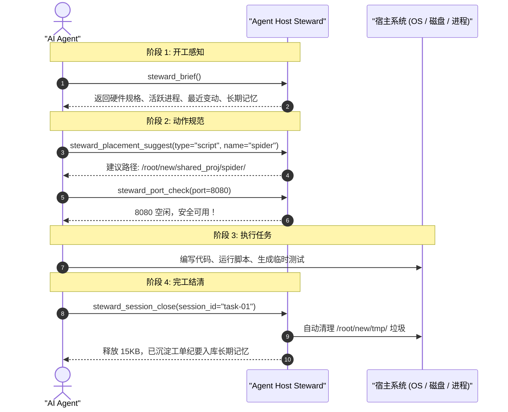

# Agent Host Steward 全景向导与部署使用技能 (agent-steward-guide)

> **定位**: 本技能内置于 `agent-steward` 项目仓库中（`skills/agent-steward-guide/SKILL.md`）。当任何 Agent 初次来到该项目、或需要将该大管家部署到新宿主机、或需要了解如何正确使用大管家时，本技能提供一站式、可实操、零废话的行动向导。

---

## 一、本项目是什么？（核心作用与定位）

### 1.1 一句话定义
**Agent Host Steward（宿主环境大管家）** 是常驻在 AI Agent 宿主机中的轻量级系统级认知底座：**管记忆、管素材、管软件环境、管动态进程、管一切静态与动态对象的位置规范**。

### 1.2 它不是什么？
- ❌ 它**不是**为了让 Agent 完成某一次具体编写代码或对话任务的协作框架（它不抢 LangChain、CrewAI 的活）；
- ❌ 它**不是**盲目的文件爬虫，绝不一股脑把宿主机扫爆；
- ❌ 它**不是**单纯的 key-value 缓存。

### 1.3 它的核心作用（解决什么核心痛点）
1. **彻底解决“跨会话失忆”**：Agent 开工第一秒，无需人工反复交代机器上有啥，调用 `steward_brief` 瞬间获取全局上下文（硬件、活跃脚本、最近资产、过往经验）；
2. **规范文件存放（放置建议 Placement Advice）**：当 Agent 产生新脚本、新工程、临时测试文件或重要笔记时，大管家主动推荐存放目录与命名模式（如工具进 `shared_proj/`、常规进 `work/`、临时进 `tmp/`），终结散落污染；
3. **分级颗粒度扫描（Granularity Tiering）**：白名单深挖到底建立 FTS5 全文索引，黑名单（`node_modules`, `.cache`, `.git`）**严格止于当前目录层级仅记标量，绝不下钻**，保护数据库不被扫爆；
4. **动态任务与进程感知**：采集非 systemd 的 Python 脚本、构建 Worker 进程与端口占用，过滤内核系统底噪，排查后台卡死；
5. **事前防撞与影响面推演**：启动服务前用 `steward_port_check` 防端口踩踏；改动核心代码前用 `steward_links_impact` 推演多跳爆炸半径；
6. **会话生命周期自洁**：任务完成调用 `steward_session_close`，自动回收 `/root/new/tmp/` 垃圾并沉淀纪要进长期记忆。

---

## 二、运行依赖与一键部署指南

大管家采用 **Rust** 编写，原生单二进制交付，依赖极简、轻量可控。

### 2.1 环境依赖要求

| 依赖组件 | 规格要求 | 用途与说明 |
|---|---|---|
| **操作系统** | Linux (Ubuntu / Debian / CentOS / 统信 / 麒麟) | 深度利用 Linux `/proc` 文件系统与 `inotify` |
| **Rust 工具链** | Rust >= 1.75 (推荐 1.99.0) + Cargo | 源码编译构建工具，安装于 `/root/.cargo/bin` |
| **SQLite3 运行环境** | 内置 Bundled FTS5 (无需外装系统级动态库) | `rusqlite` 以 bundled 特性编译，单二进制自包含 |
| **本地 Ollama (可选)** | `http://127.0.0.1:11434` (模型推荐 `bge-m3:latest`) | 提供语义向量混合检索（RRF）。若未安装自动降级为 FTS5 |

### 2.2 一键编译与本地安装

在项目根目录下执行：

```bash
# 1. 确保 Rust 工具链路径生效
export PATH="/root/.cargo/bin:$PATH"

# 2. 编译生产优化二进制 (单二进制约 8MB)
cargo build --release

# 3. 验证二进制运行正常
./target/release/agent-steward --version
# 输出: agent-steward 0.2.0

# 4. (可选) 安装到系统全局 PATH
cp target/release/agent-steward /usr/local/bin/
```

### 2.3 配置文件与初始化存储

大管家首次启动时会自动在用户家目录创建持久化存储空间：
- **数据存储**: `~/.steward/steward.db`（SQLite WAL 模式，集成 FTS5 全文虚拟表与触发器）；
- **主配置文件**: `~/.steward/config.toml`（自动从默认模板引导生成）。

默认配置文件路径与核心参数示例：
```toml
[storage]
database_path = "~/.steward/steward.db"

[daemon]
poll_interval_secs = 60
watch_paths = ["/root/new/work", "/root/new/shared_proj", "/root/new/skills"]

[memory]
ollama_endpoint = "http://127.0.0.1:11434"
default_embedding_model = "bge-m3:latest"
```

---

## 三、如何使用本项目？（三大交互通道）

大管家提供 **CLI 命令行**、**MCP 原生协议** 与 **Daemon 常驻守护** 三种等价交互方式。

### 3.1 命令行通道（CLI 实战手册）

#### 场景 1: 开工获取上下文全局简报
```bash
./target/release/agent-steward brief
```
> 输出系统 CPU/内存/磁盘、活跃动态任务（PID、命令、内存）、最近资产与长期记忆。

#### 场景 2: 新建对象前索取放置建议（Placement Advice）
```bash
# 咨询一个爬虫脚本应该放哪里
./target/release/agent-steward place suggest \
  --type script \
  --name sec_fetcher \
  --intent "抓取美国 SEC EDGAR 财报"

# 查看内置的 8 大目录规范
./target/release/agent-steward place rules
```

#### 场景 3: 启动测试服务前探测端口冲突（防撞预警）
```bash
# 检查 8080 端口是否已被占用
./target/release/agent-steward env port 8080
```
> 若冲突，自动展示占用该端口的进程 PID、名称、命令行、用户，并推荐连续空闲端口。

#### 场景 4: 修改核心代码前推演变更爆炸半径（Blast Radius）
```bash
./target/release/agent-steward links impact /root/new/shared_proj/sec_fetcher/utils.py
```
> 返回直接依赖该脚本的程序、下游定时任务及风险评级（LOW / HIGH / CRITICAL）。

#### 场景 5: 跨会话长期记忆检索（混合模式）
```bash
# 默认启用 FTS5 + Ollama 向量 RRF 混合重排
./target/release/agent-steward memory search "数据库连接池应急"

# 写入一条决策或排障经验
./target/release/agent-steward memory add \
  --type decision \
  --content "PostgreSQL 连接池溢出时，优先调低 max_connections 并开启 pgbouncer 事务池模式" \
  --summary "PG 连接池应急决策"
```

#### 场景 6: 会话结束完工结算与垃圾回收
```bash
./target/release/agent-steward close session-20261115-01 --clean-temp
```
> 自动清理 `/root/new/tmp/` 下临时残留文件，生成变更摘要并沉淀进长期记忆。

---

### 3.2 Agent 接入通道（MCP 协议接入）

本项目原生支持 **Model Context Protocol (MCP)**，通过标准 JSON-RPC 2.0 stdio 协议与任何 Agent 宿主环境无缝通信。

#### 步骤 1: 启动 MCP 服务端
```bash
agent-steward mcp
```

#### 步骤 2: Agent 客户端配置挂载
在 Agent 工具配置文件（例如 `claude_desktop_config.json` 或 Antigravity MCP 配置文件）中追加：

```json
{
  "mcpServers": {
    "agent-steward": {
      "command": "/root/new/work/agent-steward/target/release/agent-steward",
      "args": ["mcp"]
    }
  }
}
```

#### 步骤 3: Agent 可调用的 14 个核心 MCP 原生工具一览
- `steward_brief`: 一键获取全局上下文简报；
- `steward_placement_suggest`: 咨询新文件/项目放置路径与命名规范；
- `steward_placement_rules`: 查看生效的目录放置规则清单；
- `steward_asset_search`: 全文检索已知资产与文件；
- `steward_asset_register`: 手动注册新资产；
- `steward_asset_scan`: 触发指定目录白黑名单分级扫描；
- `steward_env_processes`: 查询活跃动态任务与后台脚本进程；
- `steward_env_show`: 查看硬件与操作系统规格；
- `steward_port_check`: 端口防撞检测与空闲推荐；
- `steward_memory_add`: 记录长期记忆；
- `steward_memory_search`: 混合语义与全文搜索长期记忆；
- `steward_links_query`: 查找实体依赖拓扑；
- `steward_links_impact`: 推演变更爆炸半径与下游波及；
- `steward_session_close`: 完工归档结清与环境自洁。

---

### 3.3 常驻守护进程模式（Daemon & Watcher）

如果希望宿主系统在无 Agent 交互时也能自动感知文件变更与定时巡检，可作为后台守护进程启动：

```bash
# 启动后台守护主循环 (包含 300ms inotify 文件监听 + 60s 定时巡检)
./target/release/agent-steward daemon
```

也可以通过 `systemd` 配置为开机自启服务：
```ini
[Unit]
Description=Agent Host Steward Daemon
After=network.target

[Service]
Type=simple
User=root
ExecStart=/root/new/work/agent-steward/target/release/agent-steward daemon
Restart=always
RestartSec=5

[Install]
WantedBy=multi-user.target
```

---

## 四、Agent 日常协同推荐心法（四步闭环法）

当一个 Agent 在当前机器上工作时，推荐遵循以下四步心法，让大管家发挥最大效能：



1. **进门先问候（steward_brief）**：接手任务第一件事，调用 brief 看一眼宿主机运行状态和记忆；
2. **动刀先请教（placement & port & impact）**：建新文件先问建议，起服务先查端口，改公共库先推演影响面；
3. **经验随时存（memory_add）**：攻克了棘手 bug 或做出了技术选型决策，立刻记一条长期记忆；
4. **出门随手关（session_close）**：任务结束清理垃圾并沉淀总结，保持宿主机自洁。
