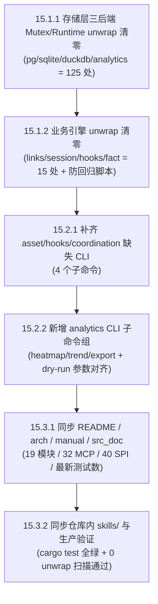
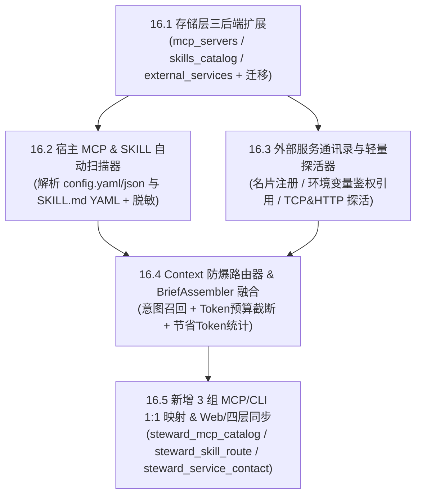

# Phase 15 & Phase 16 详细实施路线图 (Roadmap Phase 15-16)

> **编制**: Antigravity · **日期**: 2026-11-18  
> **定位**: 将 [roadmap-phase15-18.md](roadmap-phase15-18.md) 中的近期两阶段（Phase 15 规约清债 + Phase 16 生态与 Context 防爆中枢）拆解为粒度 `<= 30 分钟` 的原子可串行执行计划。  
> **断点续传追踪表**: [progress-phase15.md](progress-phase15.md)  
> **规约对齐**: [README.md 核心设计原则与约束 §1-§15](../README.md#L206-L271)

---

## 一、Phase 15：工程规约全面对齐与零 Panic 硬化

### 15.1 生产代码零 Panic 硬化（规约 #12）

| 原子任务 | 目标文件与现状计数 | 具体重构策略 | 验收门禁 |
|---|---|---|------|
| **15.1.1** | `src/storage/pg_provider.rs` (41) `src/storage/sqlite_provider.rs` (39) `src/storage/duckdb_provider.rs` (39) `src/storage/duckdb_analytics.rs` (6) | 1. 为每个 Provider 实现私有辅助方法 `fn lock_conn(&self) -> Result<MutexGuard<'_, ...>> { self.conn.lock().map_err(|e| anyhow::anyhow!("mutex poisoned: {}", e)) }`； 2. 替换 `pg_provider.rs` 中的 `Runtime::new().unwrap()` 为 `Runtime::new().context("创建 Tokio Runtime 失败")?`（或复用共享 `Arc<Runtime>`）； 3. 清理 `duckdb_analytics.rs` 内的类型转换 `.unwrap()`，改用 `.context(...)` / `unwrap_or_default()` | 4 个文件在 `#[cfg(test)]` 之前 `.unwrap(` / `.expect(` **= 0** |
| **15.1.2** | `src/links/mod.rs` (5) `src/session/lifecycle.rs` (5) `src/hooks/pipeline.rs` (3) `src/fact/automation.rs` (2) | 1. `links/mod.rs` 与 `fact/automation.rs` 中静态正则使用 `std::sync::OnceLock<Regex>` 或 `Regex::new(...).context(...)` 冒泡错误； 2. `session/lifecycle.rs` 与 `hooks/pipeline.rs` 中的 `Mutex::lock()` 改用 `.map_err(...)` 或恢复中毒守卫逻辑； 3. 在 `Makefile` 新增 `make lint-panic` 检查目标，防止未来回退 | `src/**/*.rs` 非测试代码 `.unwrap(` / `.expect(` **全局 = 0**；`cargo test` 全绿 |

### 15.2 MCP 工具与 CLI 子命令 1:1 映射补齐（规约 #13）

补齐 `src/main.rs` 中缺失的 7 个 CLI 子命令，确保 32 个原生 MCP 工具全部在命令行对等可用：

| 原子任务 | 新增 CLI 子命令 | 映射的 MCP 工具 | 关键参数与行为对齐 |
|---|---|---|---|
| **15.2.1** | `agent-steward asset register` `agent-steward hooks pre` `agent-steward hooks post` `agent-steward coordination acquire` | `steward_asset_register` `steward_hook_pre` `steward_hook_post` `steward_lock_acquire` | 1. `asset register --path <PATH> --type <TYPE> [--owner] [--security] [--description] [--desc-kv <JSON>]`； 2. `hooks pre --tool <NAME> --args <JSON>` & `hooks post --tool <NAME> --args <JSON> [--success]`； 3. `coordination acquire --resource-type <TYPE> --resource-id <ID> [--scope] [--holder] [--ttl]` |
| **15.2.2** | `agent-steward analytics heatmap` `agent-steward analytics trend` `agent-steward analytics export` `agent-steward close --dry-run` | `steward_analytics_heatmap` `steward_analytics_trend` `steward_analytics_export` `steward_session_close` | 1. `analytics heatmap [--days 30]`、`analytics trend [--metric assets] [--days 30]`、`analytics export --table <T> --output <PATH>`； 2. 顺带排查 `steward_analytics_*` 与 CLI 共用逻辑提取到 `src/storage/duckdb_analytics.rs`（避免重复代码）； 3. 为 `close` / `steward_session_close` 增加 `--dry-run` 预览开关提示（对齐规约 #8） |

### 15.3 四层贯通文档与 SKILL 刷新（规约 #10 & #11）

| 原子任务 | 涉及文件 | 同步内容 |
|---|---|---|
| **15.3.1** | `README.md`, `arch/01-for-architects.md`, `arch/02-for-developers.md`, `arch/03-for-users.md`, `manual/03-cli-reference.md`, `manual/04-mcp-integration.md`, `src_doc/development.md`, `src_doc/progress.md` | 1. 统一模块数为 **19 个核心模块**（`arch/02` 补齐 `hooks/`, `session/`, `brief/`, `changes/`, `daemon/`, `tui/`, `watcher/`, `env/`, `config/`）； 2. 统一存储 SPI 方法数为 **40 个**； 3. 统一 MCP 工具数为 **32 个**，并在 `manual/03-cli-reference.md` 补齐 7 个新增 CLI 命令及实跑输出； 4. 统一测试数为真实 `cargo test` 实测值 |
| **15.3.2** | `skills/agent-steward-developer/SKILL.md` `skills/agent-steward-doc-writer/SKILL.md` `skills/agent-steward-guide/SKILL.md` | 1. 将仓库内 3 份 `SKILL.md` 与当前代码事实对齐（32 MCP 工具、Phase 14 修复事实、最新测试门禁）； 2. 同步更新本地测试与部署说明，确保全量回归 100% PASS |

---

## 二、Phase 16：管理范围扩展与 Context 防爆路由器（对齐 Open Issue #4）

> **核心理念**：大管家为 Agent 充当**“工具/技能的按需索引目录 + 外部服务通讯录 + Context 预算守门员”**。  
> **安全与边界铁律**：
> 1. 严禁存储任何明文 API Key / Password / Token（外部服务只存 `auth_env_var` 环境变量名，扫描客户端 MCP 配置时自动剥离/脱敏 `env` 敏感键值）；
> 2. 只读扫描仅提取头部元数据与摘要（`SKILL.md` frontmatter / MCP server & tool name），遵循规约 #6 黑名单阻断原则，绝不把长文档全文灌进 Context。

### 16.1 存储层数据模型与 SPI 扩展

在 `src/storage/{schema.sql, pg_schema.sql, duckdb_schema.sql}` 同步新增 3 张核心表（含对应 FTS5 / tsvector 索引），并在 `src/storage/models.rs` 与 `src/storage/spi.rs` 扩展结构与方法：

1. **表 1：`mcp_catalog`（已纳管 MCP Server 与工具精简目录）**
   - 核心字段：`id`, `server_name` (UNIQUE), `client_source` (hermes/agy/claude/cursor/manual), `transport` (stdio/sse/http), `command_or_url`, `tools_json` (`[{name, brief_desc, est_tokens}]`), `tool_count`, `est_total_tokens`, `status` (active/disabled/unreachable), `last_scanned_at`
2. **表 2：`skills_catalog`（宿主机 SKILL 知识目录）**
   - 核心字段：`id`, `skill_name` (UNIQUE), `root_source` (`/root/new/skills` vs `~/.gemini/antigravity-cli/skills` vs `project`), `skill_path`, `description`, `triggers_json`, `est_tokens`, `has_scripts`, `has_references`, `status`, `last_scanned_at`
   - 配套 FTS5 虚拟表 `skills_catalog_fts(skill_name, description, triggers_json)` 实现毫秒级关键词/触发词检索。
3. **表 3：`external_services`（外部可用服务“联系人名单”）**
   - 核心字段：`id`, `service_name` (UNIQUE), `category` (`llm|embedding|search|database|storage|webhook|api|saas`), `endpoint`, `protocol` (`http|https|postgres|redis|grpc|stdio`), `capabilities`, `auth_type` (`none|bearer_env|api_key_env|basic_env`), `auth_env_var` (**仅存变量名如 `OPENAI_API_KEY`，严禁存密钥值**), `health_endpoint`, `usage_example`, `status` (`unknown|healthy|degraded|offline`), `last_checked_at`
   - 配套 FTS5 虚拟表 `external_services_fts(service_name, category, capabilities, usage_example)`。

- **原子任务拆解**：
  - **16.1.1**：更新三套 SQL Schema（`schema.sql`, `pg_schema.sql`, `duckdb_schema.sql`）与 `src/storage/models.rs`；
  - **16.1.2**：在 `src/storage/spi.rs` 增加 catalog CRUD/search 方法，并在 `sqlite_provider.rs`、`pg_provider.rs`、`duckdb_provider.rs` 与 `migration.rs` 同步实现且零 unwrap。

### 16.2 宿主 MCP 与 SKILL 自动扫描器 (`src/ecosystem/scanner.rs`)

- **MCP 发现来源**（只读解析，不修改客户端配置）：
  - `~/.hermes/config.yaml` (`mcp_servers.*`)
  - `~/.gemini/antigravity-cli/mcp_config.json` / `~/.config/claude/claude_desktop_config.json` / `~/.cursor/mcp.json`（存在则解析，不存在则静默跳过）
  - **脱敏门禁**：解析 `env` 字段时，仅记录变量键名清单（如 `["TAVILY_API_KEY"]`），**绝不采集和入库环境变量值**。
- **SKILL 发现来源**：
  - 扫描 `/root/new/skills/`、`~/.gemini/antigravity-cli/skills/`、`~/.gemini/antigravity-cli/builtin/skills/`、`/root/new/work/*/skills/`
  - 解析每个目录下 `SKILL.md` 的 YAML frontmatter（`name`、`description`），提取中文触发词与适用边界，统计 `SKILL.md` 字节数及估算加载成本 `est_tokens = chars / 3`。
- **原子任务拆解**：
  - **16.2.1**：实现 `McpConfigScanner`（多客户端配置解析 + 敏感字段键名脱敏 + Token 估算）；
  - **16.2.2**：实现 `SkillCatalogScanner`（YAML frontmatter 解析 + 黑名单保护 + 增量 upsert）。

### 16.3 外部服务通讯录与探活器 (`src/ecosystem/contacts.rs`)

- **设计隐喻**：为 Agent 维护一本**“宿主机外延资源联系人名单”**（类似销售人员的外部通讯录），回答“遇到 OCR/向量/搜索/数据库/通知需求时，宿主机外还能调哪些现成服务？”
- **内置安全校验**：
  - `validate_no_secret_leak()`：若传入的 `endpoint` 或 `usage_example` 或 `auth_env_var` 疑似包含硬编码密钥（如 `sk-`、`ghp_`、`password=` 明文值），直接拒绝写入或自动脱敏，确保绝不把凭证写进数据库。
- **轻量探活**：
  - 支持 TCP Connect 或 HTTP GET/HEAD 探活（默认 1500ms 超时），更新 `status` (`healthy/degraded/offline`)，严禁编造服务可用状态（规约 #5）。
- **冷启动自动发现**：
  - 从 `config.toml` 自动发现已配置的 Ollama (`embedding.ollama_url`) 与 PostgreSQL (`storage.pg_url` 脱敏主机端口后登记)；
  - 支持用户或 Agent 注册内网微服务、权威 API 网关等联系人条目。
- **原子任务拆解**：
  - **16.3.1**：实现 `ExternalContactsManager`（CRUD、防明文密钥校验、冷启动配置推导）；
  - **16.3.2**：实现轻量探活器与状态格式化输出（含“本机环境变量是否已设置 `std::env::var_os(auth_env_var).is_some()`”的零泄密就绪检查）。

### 16.4 Context 防爆路由器 (`src/ecosystem/router.rs`) 与 `BriefAssembler` 集成

- **核心算法**：
  - 输入：`intent: &str`、`budget_tokens: usize`（默认 600）、`max_skills: usize`（默认 3）、`max_mcps: usize`（默认 5）、`max_services: usize`（默认 3）。
  - 检索与打分：结合 FTS5 BM25 + 触发词精确命中 + 服务健康度加权（`healthy` 加分，`offline` 降权并提示不可用）。
  - **渐进式披露输出（Progressive Disclosure）**：
    - 仅返回最匹配的 Top-K SKILL（名称 + 1 句核心摘要 + `SKILL.md` 路径，**不展开全文**，由 Agent 按需 `read_file`）；
    - 仅返回最匹配的 Top-K MCP Server/工具提示 + 对应调用指引；
    - 仅返回最匹配的 Top-K 外部服务名片（Endpoint + `auth_env_var` 就绪状态 + 一行 curl/调用示例）；
    - 计算并附带 `context_savings`（例如：“全量 139 个 SKILL 约需 ~95,000 tokens，本次精准路由仅消耗 412 tokens，节省 99.5% 上下文”）。
- **融入 `BriefAssembler` (`src/brief/assembler.rs`)**：
  - 在 `steward_brief` 的 `query` 非空时，从原有预算中为“生态按需推荐”动态切分紧凑片段（严格受 `req.budget_tokens` 总上限约束，不撑爆 1500 tokens）。
- **原子任务拆解**：
  - **16.4.1**：实现 `ContextBudgetRouter`（多源召回、打分排序、Token 预算严格裁剪与节省估算）；
  - **16.4.2**：将该路由器接入 `BriefAssembler` 与守护进程定时巡检（`BackgroundScheduler` 定期刷新本地 SKILL/MCP 目录缓存）。

### 16.5 新增 MCP / CLI 1:1 映射与四层贯通

严格遵循规约 #10（四层贯通）与 #13（1:1 映射）：

| 新增 MCP 工具 | 对等 CLI 子命令 | 核心动作 |
|---|---|---|
| `steward_mcp_catalog` | `agent-steward mcp-catalog <scan\|list\|route>` | 扫描宿主机客户端 MCP 配置、列清单、按意图筛选 |
| `steward_skill_route` | `agent-steward skill <scan\|list\|route>` | 扫描 130+ SKILL 目录、按预算路由推荐 Top-K SKILL |
| `steward_service_contact` | `agent-steward service <register\|list\|query\|check>` | 外部服务联系人登记、查询、安全脱敏与连通性探活 |

- **原子任务拆解**：
  - **16.5.1**：在 `src/api/mcp_tools.rs` 注册上述 3 个 MCP 工具并在 `src/main.rs` 实现 1:1 对等 CLI 子命令；
  - **16.5.2**：更新 `config.example.toml`（新增 `[ecosystem]` 配置节：默认扫描路径、Token 路由默认预算、探活超时）、`src/preflight/mod.rs`（增加技能目录可读性可选检查）、`manual/`、`README.md`、`skills/agent-steward-*/SKILL.md`；
  - **16.5.3**：编写 `tests/ecosystem_integration.rs` 端到端测试 + 全系统回归（`cargo test` + `cargo check --tests` 0 warning + 非测试代码 0 unwrap 验证）+ `cargo build --release`。
