# Agent Host Steward — Phase 27 ~ Phase 28 演进路线图：实证 Benchmark 对照评测引擎、生产效能存证账本与 40/40 黑白屏全量闭环

> **编制**: Antigravity · **日期**: 2026-11-19  
> **基线 Commit**: `9ba7bca` (`v0.4.0`, Phase 1~26 全部交付，198 tests passed，39 个原生 MCP 工具黑白屏 100% 同步)  
> **对齐基准**: [README.md 核心设计原则与约束 §1-§18](../README.md#L232-L311) · [待探讨 ISSUE #13](../ISSUE.md#L73) · [10-benchmark-spec.md](../design_doc/10-benchmark-spec.md)  
> **断点续传检查点表**: [progress-phase27.md](progress-phase27.md)

---

## 一、v0.4.0 现网基线与 Benchmark 需求差距审计

### 1.1 当前实测基线数据

| 维度 | 实测基线数据 | 来源核验 |
|---|---|---|
| **代码与模块规模** | `src/lib.rs` 导出 **23 个顶层模块**；`StorageProvider` SPI 定义 **55 个方法**（SQLite / PostgreSQL / DuckDB 三后端） | `src/lib.rs`, `src/storage/spi.rs` |
| **黑屏 / 白屏对齐** | `McpToolRegistry` 注册 **39 个原生 MCP 工具**，与 CLI / Web REST API / Web UI 100% 对齐 | `src/api/mcp_tools.rs`, `src/web/server.rs` |
| **现网数据库实态** | `assets: 26,081`、`links: 6,397`、`fact_nodes: 336`、`fact_edges: 77`、`skills_catalog: 121`、`mcp_catalog: 5`、`changes: 9,364` | `/root/.steward/steward.db` (`sqlite3` 实查) |
| **工程与测试基线** | `v0.4.0` 编译零警告、`make lint-panic` 0 违规、`cargo test` 全量 **198 passed** | `Cargo.toml`, `src_doc/progress.md` |

### 1.2 核心需求差距诊断：“效果有据可查”尚缺三大闭环组件

围绕用户目标——**“把重点放在 benchmark 设计上，务必确保使用了 agent-steward 后效果有据可查”**——逐项核查当前工程实现，存在以下 3 个核心差距：

1. **差距 1 — 有“微秒级单函数测试”，缺“Without vs With Steward 端到端业务对照基准”**：
   - [tests/benchmarks.rs](../tests/benchmarks.rs) 中的 5 项测试（属性图 3 跳遍历、FTS5 检索、放置决策、DuckDB 聚合与导出）仅验证了单一模块延迟，无法量化证明在大管家介入前后 **Prompt Token 消耗、Agent 探索轮次、端口/锁冲突拦截率与垃圾文件阻断率** 的真实净收益。
2. **差距 2 — 有“静态路演 ROI 快照”，缺“生产运行态持续效能存证账本”**：
   - [src/demo/mod.rs](../src/demo/mod.rs) 的 `DemoEngine::compute_roi()` 仅做即时库存盘点；日常 Agent 每次调用 MCP/CLI/Pre-Hook 所产生的真实节省量与拦截次数没有落盘沉淀，无法回答“过去 7 天/30 天大管家到底省了多少 Token、防住了多少次事故”。
3. **差距 3 — 缺少“可溯源推导公式编号 + 防篡改报告导出 + 跨版本回归比对”**：
   - 缺少像财务账本一样的确定性规则编号（`provenance_rule`）与报告 SHA-256 指纹签名，尚未把 Benchmark 评测与账本查询升格为第 40 个黑白屏同步原语。

---

## 二、第一性原理架构方案对比与决策

针对“效果有据可查”的设计目标，对比三种候选实现方案：

| 对比维度 | 方案 A：双轨实证（真机 A/B 基准引擎 + 生产存证账本 + 40/40 黑白屏同步）（推荐） | 方案 B：静态 ROI 系数 + Markdown 固定示例 | 方案 C：外挂 Python 独立压测脚本，不接入主引擎 |
|---|---|---|---|
| **规约 #5 & #18（零捏造与有据可查）** | ✅ **100% 物理实证**：轨道 A 在同机同刻真实运行 Without vs With 对照组并落盘 SHA-256 报告；轨道 B 每次生产调用按 `PR-01~PR-08` 确定性公式记账 | ❌ 违反规约 #5/#18：缺乏物理基线采样，易流于“自说自话” | ⚠️ 仅能测单次实验，无法对日常生产 Agent 调用做持续累计存证 |
| **性能与侵入性（规约 #9）** | ✅ 记账埋点耗时 `<100 μs` 且异常静默降级，绝不阻塞主业务；微基准与宏基准覆盖 Debug/Release SLA | ✅ 零运行开销 | ✅ 对主程序无影响 |
| **产品力与可审计性（规约 #16/#17）** | ✅ 第 40 工具 `steward_benchmark` + CLI `bench` + Web「实证基准与效能账本」工作台 1:1:1 贯通，并直接为路演剧场与 PPT 供数 | ❌ 路演与真实收益脱节 | ❌ Web UI 与 MCP 客户端不可见、不可复现 |
| **结论** | ✅ **强烈推荐采纳** | ❌ 严禁采用 | ❌ 不推荐（割裂实验室与生产闭环） |

**推荐理由（第一性原理）**：真正让用户和工程团队信服的 Benchmark，不是写进 PPT 的静态百分比，而是 **“随时随地敲一条命令或点一下按钮，就能在当前这台宿主机上把裸奔代价和大管家收益现场跑一遍，并且能打开过去 7 天的生产流水账单，逐行反算出每笔节省的 Token 和拦截的风险从哪条公式来”**。

---

## 三、Phase 27 ~ Phase 28 演进路线全景图

```mermaid
flowchart LR
    P26["Phase 26: v0.4.0 基线\n(198 tests · 39 MCP · Links 闭环)"] --> P27_1["27.1 规约 #18 入宪\n(README + 10-benchmark-spec + 路线图)"]
    P27_1 --> P27_2["27.2 存储三后端 SPI 扩展\n(benchmark_runs & effectiveness_ledger)"]
    P27_2 --> P27_3["27.3 双轨基准核心引擎\n(src/benchmark: W1~W8 + M1~M5 + PR-01~08)"]
    P27_3 --> P27_4["27.4 生产调用自动记账埋点\n(mcp.rs / hooks.rs / scanner.rs / DemoEngine)"]
    P27_4 --> P27_5["27.5 第 40 工具与 CLI 1:1\n(steward_benchmark & agent-steward bench)"]
    P27_5 --> P28_1["28.1 白屏 Benchmark API\n(/api/v1/benchmark/* & 40/40 Parity 矩阵)"]
    P28_1 --> P28_2["28.2 Web 实证基准工作台\n(A/B 柱状对比 + 流水账本 + 回归 Diff)"]
    P28_2 --> P28_3["28.3 路演剧场与 PPT 证据联动\n(接入真机实测与账本锚点)"]
    P28_3 --> P28_4["28.4 四层文档/SKILL 全同步\n(手册第10章 + 热部署 + 开源镜像)"]
```

---

## 四、Phase 27 原子任务清单：实证 Benchmark 双轨内核、生产存证账本与第 40 工具/CLI

> **核心目标**：完成存储 Schema、双轨评测引擎、生产记账埋点与黑屏第 40 工具 `steward_benchmark` / CLI `agent-steward bench` 交付（预期耗时：串行 5 个 ~30 分钟原子步骤）。

| 步骤 ID | 原子任务 | 涉及文件 | 具体改造方案 | 验收门禁 |
|:---:|---|---|---|---|
| **27.1** | **规约入宪与设计规格落盘** | `README.md` `design_doc/10-benchmark-spec.md` `src_doc/roadmap-phase27-28.md` `src_doc/progress-phase27.md` `src_doc/progress.md` | 1. 在 `README.md` 新增 **规约 #18（实证基准与效能有据可查）**、顶层文档索引与 **ISSUE #13**； 2. 编制 `design_doc/10-benchmark-spec.md`（五维指标、W1~W8、M1~M5、PR-01~08、表结构与接口契约）； 3. 落盘 Phase 27~28 路线图与断点检查点表。 | 规约 #18、设计文档、路线图与检查点表落盘且链接全部有效，同步镜像仓库。 |
| **27.2** | **存储层三后端 Schema 与 SPI 扩展** | `src/storage/models.rs` `src/storage/spi.rs` `src/storage/mod.rs` `src/storage/schema.sql` `src/storage/pg_schema.sql` `src/storage/duckdb_schema.sql` `src/storage/{sqlite,pg,duckdb}_provider.rs` | 1. 新增 `BenchmarkRunRecord`、`EffectivenessLedgerRecord`、`EffectivenessSummary` 等模型结构体； 2. 在三后端 Schema 新增 `benchmark_runs` 与 `effectiveness_ledger` 表及索引； 3. `StorageProvider` SPI 新增 6 个方法（55 → 61）：`insert_benchmark_run`、`get_benchmark_run`、`list_benchmark_runs`、`insert_effectiveness_event`、`query_effectiveness_ledger`、`delete_bench_sandbox_records`，并在三后端与 `Storage` 门面全部实现。 | 0 `.unwrap()`/`expect()`；三引擎单测覆盖建表、写入、按时间窗聚合、沙盒清理，编译零警告。 |
| **27.3** | **实现 `src/benchmark/` 双轨核心引擎** | `src/lib.rs` `src/benchmark/mod.rs` `src/benchmark/provenance.rs` `src/benchmark/workloads.rs` `src/benchmark/micro.rs` `src/benchmark/ledger.rs` `src/benchmark/report.rs` `Cargo.toml`（确认 sha2 依赖） | 1. `provenance.rs`：实现确定性 `estimate_tokens(text)` 与 `PR-01`~`PR-08` 规则定义及反算说明； 2. `micro.rs`：整合 M1~M5 微基准（输出 `avg/p50/p95/p99_us` 与 Debug/Release SLA 判定）； 3. `workloads.rs`：实现 W1~W8 **Without Steward 真机基线 vs With Steward 真引擎** 成对实测，写操作严格限定在 `bench:*` 与 `TempDir` 并自动回收； 4. `ledger.rs` & `report.rs`：实现账本聚合、`compare_runs` 回归对比、Markdown/JSON/CSV/Parquet 导出与规范化 SHA-256 签名。 | `cargo test benchmark::` 全部通过；跑完 `bench:*` 后库与临时目录 0 残留；所有数据均可复现反算。 |
| **27.4** | **生产调用链路自动记账埋点与 Demo 联动** | `src/api/mcp.rs`（或 `mcp_tools.rs`） `src/api/hooks.rs` `src/scanner/mod.rs` `src/demo/mod.rs` | 1. 在 `McpToolRegistry::call_tool`（或统一分发层）根据命中工具自动匹配 `PR-01~PR-08` 记入 `effectiveness_ledger`（若 DB 写入失败仅记录 stderr/降级，绝不破坏 MCP 主响应，单次埋点 `<100 μs`）； 2. 在 `Scanner::scan_path` 记录每轮扫描阻断的 `shallow` 与 `NoiseFilter` 数量（`PR-06`）； 3. 升级 `DemoEngine::compute_roi`：读取最近一次 `benchmark_runs` 与 `effectiveness_ledger` 真实累计收益作为 ROI 锚点。 | 埋点延迟 `<100 μs`；`cargo test` 无退化；调用一次 `steward_skill_route` / `steward_hook_pre` 后 `effectiveness_ledger` 真实增长 1 条带规则编号的记录。 |
| **27.5** | **注册第 40 原生 MCP 工具、1:1 CLI 与集成基准测试** | `src/api/mcp_tools.rs` `src/main.rs` `tests/benchmarks.rs` | 1. 在 `McpToolRegistry` 注册第 40 个工具 `steward_benchmark`（支持 `run`/`report`/`ledger`/`compare`/`workloads`/`export`/`reset`）； 2. 在 `src/main.rs` 新增 `Commands::Bench`（`agent-steward bench ...`）实现 1:1 对等能力； 3. 在 `tests/benchmarks.rs` 补充 8 大工作负载 A/B 门禁断言与 ledger 出处反算集成测试。 | MCP 工具数 = 40，与 CLI 100% 一一对应；`cargo test` 全绿；`make lint-panic` 0 违规。 |

---

## 五、Phase 28 原子任务清单：Web「实证基准与效能账本」白屏工作台、路演联动与四层全量交付

> **核心目标**：打通 40/40 黑白屏双向同步，上线交互式实证基准与生产账本工作台，升级路演证据链与四层文档/SKILL 并热部署上线。

| 步骤 ID | 原子任务 | 涉及文件 | 具体改造方案 | 验收门禁 |
|:---:|---|---|---|---|
| **28.1** | **Web 后端 Benchmark REST API 与 40/40 Parity 矩阵** | `src/web/parity_api.rs` `src/web/server.rs` `src/web/api.rs` | 1. 新增 6 条路由：`GET /api/v1/benchmark/workloads`、`POST /api/v1/benchmark/run`（联动 SSE 广播）、`GET /api/v1/benchmark/report`、`GET /api/v1/benchmark/ledger`、`GET /api/v1/benchmark/compare`、`POST /api/v1/benchmark/reset`； 2. 升级 `/api/v1/parity/matrix` 将 `steward_benchmark` 纳入自检矩阵（覆盖率 = `40 / 40 = 100%`）； 3. 导出动作严格限制在 `/root/new/tmp/` 白名单目录内。 | `tests/test_web_dashboard.rs` 校验 40/40 Parity 100% 映射及 Benchmark API 契约全绿。 |
| **28.2** | **Web UI 新增「📊 实证基准与效能账本」工作台** | `src/web/assets/mod.rs` | 1. 左侧主导航新增 **「📊 实证基准与效能账本」** 视图，适配白天蓝图 / 夜间深空双主题与黑屏命令镜像底栏； 2. **实证实验室卡片**：支持一键运行全套或单选 W1~W8/M1~M5，可视化呈现 Baseline vs Steward 双柱对比条、加速比、Token 节省率与 SHA-256 签名； 3. **生产效能存证账本面板**：按 `24h / 7d / 30d / all` 与 `PR-01~08` 维度聚合，展示累计节省 Token、缩减轮次、拦截风险、阻断噪音及每笔流水推导依据（`evidence_summary`）； 4. **跨批次回归对比面板**：下拉选择两次 `run_id`，高亮性能提升/退化项。 | Playwright 实测双主题下无文字遮挡/溢出、0 console error、点击运行基准与查询账本正常渲染。 |
| **28.3** | **路演演示剧场与双 HTML PPT 实证锚点联动** | `src/demo/mod.rs` `src/web/assets/mod.rs` `presentation.html` `steward-deck.html` | 1. 路演剧场顶部 ROI 栏与各幕详情卡片增加“🔬 实证基准来源（关联最新 `run_id` 与生产账本统计）”，彻底区分“沙盒演示”与“历史实测存证”； 2. 刷新 `presentation.html` 与 `steward-deck.html` 中的 MCP 工具数（40 个）及实测基准成绩页面（基于真机跑批数据，绝不虚构）。 | 路演剧场与 PPT 数据与实机 `agent-steward bench report` 100% 一致，Playwright 渲染自检全绿。 |
| **28.4** | **四层贯通文档、配置、SKILL 同步与现网热部署** | `manual/10-benchmark-and-roi.md`（新建） `manual/{README,03,04,08}.md` `arch/{01,02,03}.md` `config.example.toml` `src/config/mod.rs` `skills/agent-steward-*` `src_doc/{development,product-manual,progress}.md` | 1. 新增 `[benchmark]` 配置段（控制是否开启生产记账、基准测试并发与导出目录白名单）并接入 `config.example.toml`； 2. 编写 `manual/10-benchmark-and-roi.md` 并同步 `manual/03,04,08`、`arch/01~03`、`src_doc/` 与 3 处全局 `SKILL.md`（仓库 + `/root/new/skills/` + `/root/.gemini/antigravity-cli/skills/`）； 3. 全量门禁测试（`make lint-panic`、`cargo check --tests`、`cargo test`、`cargo build --release`），实跑一次 `agent-steward bench run --save` 验证现网结果，热重启 `agent-steward.service` 并 `rsync` 至 `/root/new/shared_git/agent-steward`。 | `make lint-panic` 0 违规、`cargo check --tests` 0 警告、`cargo test` 全绿、3 处 SKILL SHA-256 一致、现网 `agent-steward bench ledger` 可查真实账单。 |

---

## 六、DoD 总体交付门禁（验收红线）

1. **有据可查与零捏造硬门禁（规约 #5 & #18）**：所有 Without Steward 基线必须源自同机物理探针或真目录/真库采样，所有生产账本收益必须携带 `PR-01`~`PR-08` 推导公式编号与 `evidence_summary`，基准报告必须带可校验的 SHA-256 指纹签名。
2. **黑白屏 40/40 双向同步门禁（规约 #16）**：`GET /api/v1/parity/matrix` 与集成测试必须验证 **40 个 MCP 工具 × CLI × SKILL × Web REST API/UI 100% 映射**。
3. **隔离沙盒零污染门禁**：`agent-steward bench run` 产生的所有临时文件与测试锁严格限制在 `TempDir` 与 `bench:*` 命名空间，执行完毕自动清除，不污染生产表与真实工作区。
4. **零 Panic 与零警告红线（规约 #12 & #13）**：生产路径保持 0 处 `.unwrap()` / `.expect()`，`cargo check --tests` 0 warning，`cargo test` 全绿。
5. **四层贯通闭环（规约 #10 & #11）**：代码、配置、`manual/10` + 手册、`SKILL.md`（三处镜像一致）、守护进程热部署与 `/root/new/shared_git/agent-steward` 全部同步到位。
