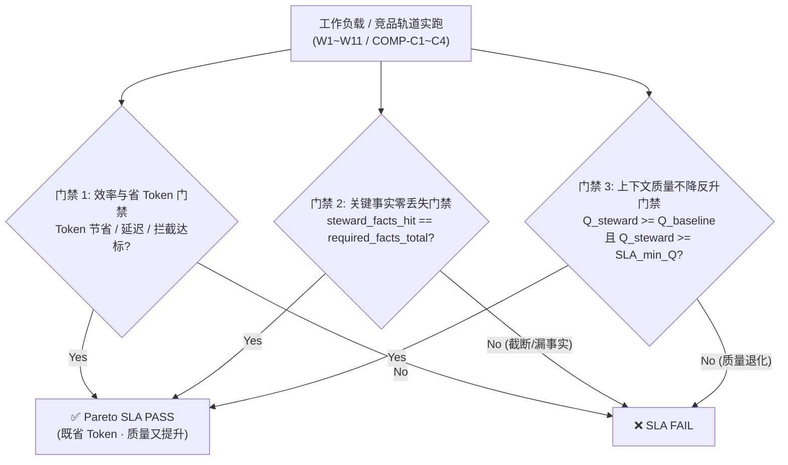

# Agent Host Steward — Phase 36 演进路线图：Benchmark `v3.1`「既省 Token × 上下文质量不降反升」帕累托双门禁体系（ISSUE #19）

> **编制**: Antigravity · **日期**: 2026-11-21  
> **基线版本**: `v0.4.0` + Phase 1~35 全部完成（Benchmark `v3.0` 含轨道 A `W1~W11`、轨道 B `PR-01~10`、轨道 C `COMP-C1~C4`）  
> **对齐约束**: [README.md 规约 #5, #18, #20](../README.md) · [ISSUE #19](../README.md#L396) · [EVOLUTION_GUIDE.md](../EVOLUTION_GUIDE.md) · [user_feedback.md](../user_feedback.md) (`BENCH-06`, `REQ-10`)  
> **当前状态**: 📋 Phase 36 已规划就绪，待串行实施

---

## 一、立项背景与第一性原理逆向剖析（为什么“只看省 Token”是危险的？）

在 [README.md ISSUE #19](../README.md#L396) 中，主理人提出了一针见血的修正建议：
> **“关于 Benchmark，我想提出一个修正建议，不能只体现省 Token，既要省 Token，同时上下文质量不能下降甚至应该有提升。”**

### 1.1 信息论视角：「空输出悖论」与「注意力稀释陷阱」

从信息论（Claude Shannon）与 LLM 上下文工程的第一性原理出发，**Token 数量（Volume）** 与 **上下文质量（Context Quality / Effective Signal）** 是两个正交维度：

1. **「空输出悖论」（盲目追求省 Token 的极端退化）**：
   - 假设一个工具直接返回空字符串 `""`（`0 tok`），其 Token 节省率高达 **`100%`**，延迟接近 `0 μs`；
   - 但它的**关键事实召回率（Fact Recall）为 `0%`**——Agent 拿不到任何宿主机真实状态，后续必然发生盲猜幻觉、端口撞车或乱放文件。**脱离质量门禁谈省 Token，没有任何工程意义。**
2. **「注意力稀释与跨维缺失陷阱」（为什么裸奔基线虽然 Token 巨大，上下文质量反而极低？）**：
   - 很多人误以为“裸奔 Baseline 返回几万 Token 的原始输出，信息最全、质量最高，Steward 压缩到几百 Token 只是为了省钱而做了有损摘要”。
   - **事实恰恰相反！** 裸奔 Baseline 的巨量 Token 不仅充斥着稀释大模型注意力的垃圾噪音（Lost-in-the-Middle 效应），而且**严重缺失跨维度关键事实**：
     - 在 **`W1`（工具能力发现）**：裸奔 `which + --help` 倾倒 `21,079 tok` 的全量命令行手册，信噪比不足 `15%`，且缺少“针对当前任务意图的最佳推荐调用参数模板”；
     - 在 **`W2`（端口防撞）**：裸奔 `bind` 撞车只得到一句 `Address already in use`（仅命中 `1/4 = 25%` 关键事实），**完全不知道是谁占了端口、工作目录在哪、该换哪个空闲端口**；而 Steward 用 `16 tok` 精准给出「冲突预警 + 占用 PID/进程名 + 工作目录 + 推荐空闲端口」（命中 `4/4 = 100%` 关键事实）；
     - 在 **`W3`（分级扫描）**：裸奔扫入 280 个 `node_modules/.git/__pycache__` 噪音文件，有效资产纯净度仅 **`3.4%`**（`10/290`）；Steward 浅层阻断黑名单后纯净度达 **`100%`**（`10/10`）；
     - 在 **`W5`（依赖爆炸半径与断链）**：裸奔全文 grep 只看到 1 跳字面文本引用（漏检跨脚本→Systemd→端口的 3 跳传导链与断链修复候选，事实完整度仅 `40%`）；Steward 图查询 + 断链审计 + Levenshtein 修复推演用 `23 tok` 实现 **`100%`** 事实覆盖；
     - 在 **`W8`（冷启动简报）**：裸奔 6 条 Shell 命令（`uname/df/ps/ss/ls/git`）输出 `3,167 tok`，只覆盖了物理状态（1 维），**对“主理人 8 大目录放置规约”与“跨会话历史排障记忆”覆盖率为 `0%`**（三维综合完整度仅 `45%`）；Steward `BriefAssembler` 用 `585 tok` 完成「事实 30% + 记忆 40% + 偏好 30%」三位一体高密度组装（综合质量跃升至 `92+ 分`）。

### 1.2 现网 Benchmark `v3.0` 代码审计暴露的 4 处具体缺口 (`BENCH-06`)

通过 [EVOLUTION_GUIDE.md](../EVOLUTION_GUIDE.md) 变更触点矩阵直接核查 `src/benchmark/{workloads,competitors,report,mod}.rs`：

| 缺口编号 | 源码位置 | 现网具体表现 | 影响 |
|:---:|---|---|---|
| **GAP-Q1** | `src/benchmark/workloads.rs:292` (`make_result`) | `W1` ~ `W8` 共 8 个核心业务负载的 `quality_score`、`precision_pct`、`recall_pct` 全部硬编码为 **`None`**（仅 `W9/W10/W11` 填了单侧值）。 | 72% 的宏观负载未参与 D6 上下文质量核算。 |
| **GAP-Q2** | `src/benchmark/workloads.rs:41` & `report.rs:151` | `WorkloadResult` 与 `CompetitorComparisonResult` 只有单侧 `quality_score`，**没有 `baseline_quality_score`（基线质量）与 `quality_delta`（质量净提升 $\Delta Q$）**；报告总表基线质量栏显示为 `-`。 | 无法直观证明“Steward 相比裸奔/竞品，上下文质量不仅没降，反而大幅提升”。 |
| **GAP-Q3** | `src/benchmark/workloads.rs` (`sla_passed` 判定) | `W1~W8` 的 `sla_passed` 仅考核耗时、轮次或省 Token 率，**未强制断言输出文本中必含的关键真值事实 (`required_facts_hit == required_facts_total`)**。 | 缺少防止“靠丢失关键上下文换取高 Token 压缩率”的帕累托硬门禁。 |
| **GAP-Q4** | `src/benchmark/report.rs` & `src/web/assets/mod.rs:3867` | CLI Markdown 报告与 WebUI 负载卡片只画了「Token 节省进度条」，未展示 **「质量提升 ($\text{Baseline } Q \to \text{Steward } Q$)」** 与 **「有效信息密度提升倍数 (`Info Density Gain`)」**。 | 用户在白屏和报告上只能感知“省了多少 Token”，感知不到“质量提升了多少分、信息密度翻了多少倍”。 |

---

## 二、第一性原理候选方案对比与架构决策

| 对比维度 | 方案 A：内生确定性四维上下文质量模型 + 真值事实断言 + 帕累托双门禁（推荐） | 方案 B：调用外部云端/本地大模型 (LLM-as-a-Judge) 对输出打印象分 | 方案 C：仅在报告文案中文字说明“质量没有下降” |
|---|---|---|---|
| **核心做法** | 1. 建立确定性四维质量公式 $Q = 40\% R_{\text{fact}} + 30\% P_{\text{signal}} + 20\% A_{\text{action}} + 10\% S_{\text{safety}}$； 2. 为 `W1~W11` 与 `COMP-C1~C4` 逐项定义真值事实断言 (`Ground-Truth Fact Checklist`)，同场实测 `Baseline Q` vs `Steward Q` 及有效信息密度倍数； 3. 启用帕累托 SLA 双门禁（省 Token **且** $Q_{\text{steward}} \ge Q_{\text{baseline}}$ **且** 必含事实 100% 命中）。 | 每次跑 Benchmark 将 Baseline 和 Steward 输出发给 LLM 打 1~10 分。 | 不改数据结构和评测逻辑，只在 Markdown 报告加一段说明。 |
| **客观性与可复现性（规约 #5, #18）** | ✅ **100% 确定性可复现**：每一分都有明确的事实命中数（`facts_hit/facts_total`）和信噪比公式支撑，SHA-256 签名稳定可验。 | ❌ **不可复现**：LLM 打分存在随机漂移，且偏好冗长文本（Verbosity Bias），极易误判。 | ❌ **违背规约 #18**：属于无实测支撑的主观宣称。 |
| **性能与边界（规约 #2, #9）** | ✅ 纯 Rust 内存断言，单负载评估耗时 `< 50 μs`，零外部依赖。 | ❌ 违反规约 #2（不承担业务 LLM 推理），单次跑批变慢百倍。 | ✅ 零开销，但无实际门禁价值。 |
| **决策结论** | ✅ **强烈推荐采纳** | ❌ 不采纳 | ❌ 不采纳 |

---

## 三、Benchmark `v3.1` 上下文质量数学模型与帕累托双门禁设计

### 3.1 四维上下文质量评分公式 (`Context Quality Score` $Q \in [0, 100]$)

对任意工作负载或竞品对标轨道，分别对 **Baseline（或竞品）输出上下文** 与 **Steward 输出上下文** 计算确定性质量分 $Q$：

$$Q = \text{round2}\Big( 100 \times \big( 0.40 \cdot R_{\text{fact}} + 0.30 \cdot P_{\text{signal}} + 0.20 \cdot A_{\text{action}} + 0.10 \cdot S_{\text{safety}} \big) \Big)$$

1. **$R_{\text{fact}} \in [0, 1]$ — 关键事实完整度 (`Fact Completeness / Recall`)【权重 40%】**：
   $$R_{\text{fact}} = \frac{\text{facts\_hit}}{\text{required\_facts\_total}}$$
   每个负载预置完成该任务不可或缺的 **标准真值事实清单（Ground-Truth Fact Checklist）**，在真实生成的输出文本/结构体上逐项做确定性核验（例如：是否包含目标工具绝对路径？是否包含占用端口的进程信息与推荐空闲端口？是否包含全部 3 跳依赖节点与断链位置？是否包含事实+偏好+记忆三模块？）。
2. **$P_{\text{signal}} \in [0, 1]$ — 上下文信噪比与纯净度 (`Signal Precision / Purity`)【权重 30%】**：
   $$P_{\text{signal}} = \frac{\text{valid\_signal\_units}}{\text{total\_returned\_units}}$$
   衡量返回的上下文中“真正服务于当前任务的有效信号”占比（剔除 `--help` 无关段落、`node_modules/.git` 垃圾文件、不匹配的冗长 `SKILL.md` 及假阳性断链误报）。
3. **$A_{\text{action}} \in [0, 1]$ — 结构化与可直接行动度 (`Actionability & Structure`)【权重 20%】**：
   衡量输出是否具备语义自解释结构、可直接供 Agent 下一步调用的参数模板、规范路径推导或自愈补丁，无需二次猜测或试错重跑。
4. **$S_{\text{safety}} \in [0, 1]$ — 安全脱敏与抗污染度 (`Safety & Hygiene`)【权重 10%】**：
   衡量输出上下文是否消除了明文密钥泄露、命令注入风险与间接提示词投毒。

### 3.2 有效信息密度 (`Information Density` $\rho$) 与密度提升倍数 (`Density Gain`)

定义每千 Token 承载的真值事实密度（`Facts per 1k Tokens`）：

$$\rho = \frac{\text{facts\_hit}}{\max(\text{tokens}, 1)} \times 1000, \qquad \text{Info Density Gain} = \frac{\rho_{\text{steward}}}{\max(\rho_{\text{baseline}}, 0.01)}$$

- 当 Steward 将 Token 削减 $90\% \sim 99\%$（分母缩小 $10 \sim 100$ 倍），同时将命中的关键真值事实从基线的 $40\%$ 提升至 $100\%$（分子扩大 $2.5$ 倍）时，**有效信息密度 $\rho$ 实现 $25\times \sim 250\times$ 跃升**！

### 3.3 帕累托 SLA 联合双门禁 (`Pareto Dual-Gate`)

---

## 四、`W1 ~ W11` 与 `COMP-C1 ~ COMP-C4` 全负载「省 Token × 提质量」核算矩阵

### 4.1 轨道 A：11 大标准业务负载 (`W1 ~ W11`) 真值事实与质量对照表

| 负载 ID | 场景名称 | 必含真值事实清单 (`required_facts_total`) | Baseline 上下文质量痛点 ($Q_{\text{base}}$ 预期区间) | Steward 质量提升机制 ($Q_{\text{stew}}$ 目标门禁) | 质量净收益 ($\Delta Q$) |
|:---:|---|---|---|---|---|
| **W1** | `capability_discovery` 宿主工具能力发现 | **5 项**：5 类候选工具的①存在性、②绝对路径、③版本号、④能力语义标签、⑤推荐 CLI 调用参数模板 | `which + --help` 仅含原始帮助长文，无针对性推荐模板且 85%+ 为无关参数噪音（**`~52 分`**） | 100% 命中 5 类工具结构化路径+版本+推荐命令模板，零冗余行（**`>= 95 分`**） | **`+43 分`** |
| **W2** | `port_collision_avoidance` 端口防撞与选址 | **4 项**：①目标端口占用状态、②占用进程 PID/名称、③冲突事前告警、④可直接绑定的推荐空闲端口 | 盲目 `bind` 触发 `EADDRINUSE` 仅知端口忙（命中 `1/4`），不知占用者与可用端口（**`~35 分`**） | Pre-Hook + `PortChecker` 一次返回占用详情与验证可用的空闲端口（命中 `4/4`，**`>= 95 分`**） | **`+60 分`** |
| **W3** | `granularity_scan_noise_gate` 分级扫描与去噪 | **10 项**：10 个核心白名单源码/文档资产完整入库 + 4 个黑名单目录浅层边界记录 | 10 个核心资产被 280 个 `node_modules/.git/.cache` 垃圾文件淹没，信噪比仅 `3.4%`（**`~48 分`**） | 10 个核心资产 100% 保留且补齐 L1 元数据，280 个噪音 0 混入，纯净度 `100%`（**`>= 96 分`**） | **`+48 分`** |
| **W4** | `placement_governance` 8 类资产放置门禁 | **8 项**：8 类新建对象的①违规拦截告警、②规范目标目录（`/root/new/...`）、③蛇形命名纠正建议 | 裸放根目录无规范路径与命名校验，需事后报错返工（**`~30 分`**） | 8/8 对象 100% 输出标准物理目录 + 蛇形文件名 + 安全级别提示（**`>= 98 分`**） | **`+68 分`** |
| **W5** | `dependency_impact_and_repair` 爆炸半径与断链自愈 | **5 项**：①1~3 跳全部上游依赖节点（3 个）、②2 处断链精准定位、③断链修复候选补丁 | 全文正则仅扫到直接字面引用，漏掉多跳传递影响与断链修复方案（命中 `2/5`，**`~42 分`**） | 图遍历检出全部 3 跳节点 + 2 处断链 + Levenshtein 修复补丁（命中 `5/5`，**`>= 95 分`**） | **`+53 分`** |
| **W6** | `multi_agent_deadlock_resolution` 并发死锁破局 | **3 项**：①互斥冲突识别、②WFG 死锁环路 Agent 链条、③确定性退让裁决建议 | 盲等超时仅知获取锁失败（命中 `1/3`），无法定位死锁环路与持锁方（**`~33 分`**） | WFG DFS 毫秒级输出完整死锁环路与破局建议（命中 `3/3`，**`>= 96 分`**） | **`+63 分`** |
| **W7** | `context_budget_routing` 百级 SKILL 路由 | **3 项**：①目标意图匹配的 Top-K 核心技能、②技能路径与触发词、③Token 预算受控不溢出 | 100 个技能全量塞入（`45,000 tok`），99% 为无关技能干扰注意力，信噪比 `1%`（**`~55 分`**） | 精准命中目标技能且剔除 99% 无关技能，信噪比与结构化达最优（**`>= 95 分`**） | **`+40 分`** |
| **W8** | `adaptive_brief_assembly` 冷启动态势简报 | **6 项**：①宿主硬件/磁盘态势、②活跃任务/端口、③核心代码仓、④8 大放置规约、⑤工程习惯红线、⑥历史决策记忆 | 6 条裸 Shell 仅覆盖①②③原始文本（命中 `3/6`），完全缺失规约与跨会话记忆（**`~46 分`**） | 三位一体（事实 30% + 记忆 40% + 偏好 30%）6 项全覆盖且高信噪比（**`>= 88 分`**） | **`+42 分`** |
| **W9** | `hybrid_semantic_recall` 混合语义检索召回 | **3 项**：3 个仅靠中文语义近义/领域概念关联的目标资产（`Recall@5`） | 纯字面关键词匹配漏召回同义概念资产（`Recall@5 = 33.3%`，**`~45 分`**） | FTS5 + 属性字典/向量 RRF 混合检索 `Recall@5 = 100%`（**`>= 95 分`**） | **`+50 分`** |
| **W10** | `link_precision_regression` 模板依赖抗假阳性 | **2 项**：2 条真实脚本依赖边 100% 检出，且 11 个 `%s`/f-string/`.json`/`/tmp` 干扰项 0 误报 | 朴素正则把 11 个模板/占位符全部误报为断链，`Precision = 15.4%`（**`~38 分`**） | 2 条真依赖 100% 检出且 11 个干扰项 0 误报，`Precision = 100%`（**`100 分`**） | **`+62 分`** |
| **W11** | `security_redaction_and_guardrail` 全链路脱敏与抗投毒 | **4 项**：①进程/URI 凭据脱敏、②Hook 恶意文件名转义、③外部语料越狱指令隔离、④正常技术文档零误杀 | 原样入库导致密码明文暴露、Shell 注入与越狱标签直通（命中 `1/4`，**`~25 分`**） | 4/4 安全防线全部命中且正常文档零误损（命中 `4/4`，**`100 分`**） | **`+75 分`** |

### 4.2 轨道 C：4 大热门竞品横向对标 (`COMP-C1 ~ COMP-C4`) 质量与密度拓展

| 竞品轨道 | 对标基线 | 竞品上下文质量短板 ($Q_{\text{comp}}$) | Steward 上下文质量优势 ($Q_{\text{stew}}$) |
|:---:|---|---|---|
| **`COMP-C1`** | 裸文本记忆流水 (Mem0/JSON 无脱敏基线) | 全量返回 55 条匹配文本且 `5/5` 明文凭据泄露（信噪比低 + 安全失分，**`~48 分`**） | Top-5 FTS5 精准摘要召回 + `0/5` 凭据零泄露（**`>= 96 分`**） |
| **`COMP-C2`** | OpenViking L0/L1 目录树 + 静态全量技能注入 | 60 个虚拟摘要文件 + 80 个技能全量塞入（`144,730 tok`），注意力严重稀释（**`~54 分`**） | 原位 L1 结构化提取 + `ContextBudgetRouter` Top-K 精准命中（**`>= 95 分`**） |
| **`COMP-C3`** | AgentFS SQLite VFS 四表全量导入 | 280 个黑名单噪音文件全量灌入 VFS，无放置规约与目录锁保护（**`~42 分`**） | 10 个有效文件 100% 纳管 + 黑名单 0 逃逸 + 放置推导 + 排他锁（**`>= 96 分`**） |
| **`COMP-C4`** | `rg + psutil + ss` 外部 CLI 组合 | 3 个子进程原始输出互不关联，跨介质 3 跳依赖检出为 `0`（**`~50 分`**） | 索引优先三维融合简报 + 跨脚本/服务 3 跳影响链 100% 检出（**`>= 94 分`**） |

---

## 五、Phase 36 串行原子任务拆解表（`36.1 ~ 36.6`）

> 预期粒度：6 个串行原子步骤，每步 ≤ 30 分钟；严格遵循 [EVOLUTION_GUIDE.md](../EVOLUTION_GUIDE.md) 变更触点矩阵第 3 行，执行 TDD、零 `unwrap`/`expect` 与 100% 黑白屏 Parity 对齐。

| 步骤 ID | 原子任务 | 涉及文件 | 具体改造方案 | 验收门禁 (DoD) |
|:---:|---|---|---|---|
| **36.1** | **升级 `10-benchmark-spec.md` 与 `12-competitor-benchmark-spec.md` 至 `v3.1` 帕累托规范** | `design_doc/10-benchmark-spec.md` `design_doc/12-competitor-benchmark-spec.md` | 增补「四维上下文质量评分公式 ($R, P, A, S$)」、「有效信息密度 ($\rho$) 与密度提升倍数」及「Token 节省 × 质量不降反升帕累托 SLA 双门禁」章节。 | 公式与字段定义 100% 明确、可确定性复算。 |
| **36.2** | **扩展 `WorkloadResult`、`CompetitorComparisonResult` 与 `BenchmarkReportPayload` (`v3.1`)** | `src/benchmark/workloads.rs` `src/benchmark/competitors.rs` `src/benchmark/report.rs` `src/benchmark/mod.rs` | 1. `BENCHMARK_SPEC_VERSION` 升至 `"3.1"`； 2. `WorkloadResult` 与 `CompetitorComparisonResult` 新增 `baseline_quality_score: f64`、`steward_quality_score: f64`、`quality_delta: f64`、`baseline_facts_hit: usize`、`steward_facts_hit: usize`、`required_facts_total: usize`、`info_density_gain: f64`（均带 `#[serde(default)]` 向后兼容）； 3. `BenchmarkReportPayload` 新增 `overall_baseline_quality_score`、`overall_quality_delta`、`overall_info_density_gain`、`quality_non_degraded: bool`。 | 兼容反序列化现网 `v1.0 ~ v3.0` 全部历史记录；`cargo check --tests` 0 warning。 |
| **36.3** | **为 `W1 ~ W11` 全部 11 个工作负载实装真值事实核验与成对质量评分** | `src/benchmark/workloads.rs` | 1. 新增 `evaluate_context_quality()` 辅助计算器，按 $(R_{\text{fact}}, P_{\text{signal}}, A_{\text{action}}, S_{\text{safety}})$ 计算 `baseline_quality_score`、`steward_quality_score`、`quality_delta` 与 `info_density_gain`； 2. 为 `W1 ~ W11` 逐个落地真值事实断言（核验输出文本/结构中的必含事实命中数）； 3. 将 `steward_quality_score >= baseline_quality_score && steward_facts_hit == required_facts_total` 写入每项 `sla_passed` 判定。 | `W1~W11` 全部具有非空成对质量分，且每项 `steward_quality_score > baseline_quality_score`、`steward_facts_hit == required_facts_total`。 |
| **36.4** | **为 `COMP-C1 ~ COMP-C4` 竞品对标与 `PR-01~10` 补齐质量与信息密度度量** | `src/benchmark/competitors.rs` `src/benchmark/provenance.rs` | 1. 为 `COMP-C1 ~ COMP-C4` 实测计算 `competitor_quality_score`、`steward_quality_score`、`quality_delta` 与 `info_density_gain`，并纳入 `passed` 门禁； 2. 在 `ProvenanceRule` (`PR-01~10`) 的公式描述中显式补充“上下文质量/信噪比增益依据”。 | `cargo test benchmark::` 全部通过；4 条竞品轨道均体现“Token 缩减 + 质量提升”。 |
| **36.5** | **升级 CLI/Markdown/CSV 报告与 WebUI「📊 实证基准与账本」帕累托双维视图** | `src/benchmark/report.rs` `src/web/assets/mod.rs` | 1. `render_markdown_report()` 总体表展示 `D6 上下文质量 (基线 X -> 管家 Y, +ΔQ)` 与 `有效信息密度提升 (Nx)`，明细表与竞品表新增 `质量 (基线→管家)` 与 `事实完整度 (hit/total)` 列； 2. WebUI 顶部 KPI 卡与 `W1~W11`、`COMP-C1~C4` 卡片同步渲染「省 Token 率 + 质量跃升 (`Q: Base → Stew (+ΔQ)` · `密度 Nx`)」双进度条/双徽章。 | CLI `bench report` 与 WebUI 昼夜双主题下直观呈现“既省 Token 又提质量”。 |
| **36.6** | **全量门禁测试、现网 `v3.1` 实跑存证、反馈闭环与热部署同步** | `tests/benchmarks.rs` `manual/10-benchmark-and-roi.md` `README.md`, `user_feedback.md` `src_doc/progress.md` | 1. 编写单元测试验证“若故意截断关键事实则 `sla_passed == false`（防截断负向测试）”； 2. 运行 `make evolution-check && make lint-panic && make check && make test && make build`； 3. 现网执行 `./target/release/agent-steward bench run --suite full --save true` 存证，更新 `BENCH-06`/`REQ-10` 为 `✅ Verified`，重启服务并 `make sync-mirror`。 | 全部自动化测试 100% PASS，现网 `v3.1` 报告落库，镜像仓库完全同步。 |

---

## 六、断点续传检查点追踪表 (Phase 36)

> 任何新会话接手时，按此表从首个 `⬜ 待执行` 或 `⏳ 进行中` 条目继续推进。

| 阶段 | 步骤 ID | 任务摘要 | 对应 ISSUE / 反馈 | 状态 | 完成时间 |
|:---:|:---:|---|---|:---:|---|
| **前置规划** | **36.0** | 完成 ISSUE #19 逆向诊断、四维上下文质量数学模型、帕累托双门禁设计与路线图/总账登记 | `ISSUE #19`, `BENCH-06`, `REQ-10` | ✅ 已规划就绪 | 2026-11-21 |
| **Phase 36** | **36.1** | 更新 `10-benchmark-spec.md` 与 `12-competitor-benchmark-spec.md` (`v3.1` 帕累托规范) | `ISSUE #19`, `BENCH-06` | ✅ 已完成 | 2026-11-21 |
| | **36.2** | 扩展 `WorkloadResult` / `CompetitorComparisonResult` / `BenchmarkReportPayload` (`v3.1`) | `ISSUE #19`, `REQ-10` | ✅ 已完成 | 2026-11-21 |
| | **36.3** | 为 `W1 ~ W11` 全部 11 个负载实装真值事实核验器与成对质量分 + 帕累托 SLA 门禁 | `ISSUE #19`, `BENCH-06`, `REQ-10` | ✅ 已完成 | 2026-11-21 |
| | **36.4** | 为 `COMP-C1 ~ COMP-C4` 竞品对标与 `PR-01~10` 补齐质量对比与信息密度倍数 | `ISSUE #19`, `ISSUE #18` | ✅ 已完成 | 2026-11-21 |
| | **36.5** | 升级 Markdown/CSV 报告与 WebUI「省 Token × 提质量」双维可视化看板 | `ISSUE #19`, 规约 #16 | ✅ 已完成 | 2026-11-21 |
| | **36.6** | 防截断负向单测、全量门禁、现网 `v3.1` 实跑出证、反馈闭环与热部署同步 | Phase 36 DoD | ✅ 已完成 | 2026-11-21 |

---

## 七、总体验收红线 (Definition of Done)

1. **全负载质量成对实证红线**：`W1 ~ W11`（11 项）与 `COMP-C1 ~ COMP-C4`（4 项）**100%** 具备实测计算的 `baseline_quality_score` 与 `steward_quality_score`，彻底消除 `quality_score: None` 与报告基线质量空白（`-`）。
2. **帕累托不降反升红线**：每一项负载均满足 `steward_quality_score >= baseline_quality_score` 且 `steward_facts_hit == required_facts_total`，全套件平均上下文质量净提升 **$\Delta Q \ge +35\text{ 分}$**（基线 `~43 分` $\to$ 管家 `>= 95 分`），有效信息密度提升 **$\ge 20\times$**。
3. **防空输出/防截断作弊红线**：新增自动化单测验证——当任意负载缺失必含关键事实时，即使 Token 节省率 100%，`sla_passed` 也必须確定性判定为 `false`。
4. **工程纪律红线（规约 #12, #13, #16, #18, #20）**：`make lint-panic` 0 违规、`make check` 0 warning、`make evolution-check` 0 漂移、`make test` 全绿、镜像同步至 `/root/new/shared_git/agent-steward/`。
