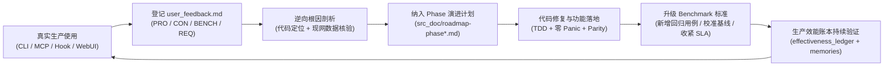

# Agent Host Steward — 实际使用反馈总账 (`user_feedback.md`)

> **文档定位**: 主理人（Human）与智能体（AI Agent）在真实生产环境中高频使用 `agent-steward` 后沉淀的一手反馈权威总账。  
> **首次建立**: 2026-11-19 (基于现网 `v0.4.0` + Phase 29 状态实测盘点)  
> **关联路线图**: [roadmap-phase30.md](src_doc/roadmap-phase30.md) · [progress-phase30.md](src_doc/progress-phase30.md) · [10-benchmark-spec.md](design_doc/10-benchmark-spec.md)

---

## 一、反馈治理闭环与编号约定 (Feedback-to-Benchmark Flywheel)

本文件拒绝“只吐槽不落地”或“只修 Bug 不更新评测标准”。每一条进入 `user_feedback.md` 的有效反馈，必须绑定唯一编号并沿闭环流转，最终转化为**代码修复 + 持久化记忆 + 升级版 Benchmark 回归门禁**。



### 1.1 四类反馈编号体系

| 编号前缀 | 类别 | 核心用途 |
|:---:|---|---|
| **`PRO-XX`** | 实际使用优点 | 记录已通过真机实测验证的高价值优势特性（含实证命令与量化数据），避免后续重构退化。 |
| **`CON-XX`** | 缺点、痛点与缺陷 | 记录真实使用中的慢路径、误报噪音、记账漏失、记忆冷清或交互摩擦（含复现命令、代码定位与目标 SLA）。 |
| **`BENCH-XX`** | Benchmark 标准失真与迭代诉求 | 专门记录在对照现网数据时暴露出的基线不等价、指标算法扭曲、维度缺失或覆盖盲区，驱动 Benchmark 持续升级。 |
| **`REQ-XX`** | 新需求与架构演进 | 记录从日常 Agent 协作场景中生长出的新能力诉求，严守产品边界（规约 #2）后再排期立项。 |

### 1.2 状态流转字典

- `📥 Open`：已登记并核验现网事实，等待排期；
- `🗓️ Planned`：已纳入具体 Phase 演进路线图与原子任务清单；
- `⏳ In Progress`：正在按路线图实施开发；
- `✅ Verified`：已完成代码修复、通过全量测试与新 Benchmark 门禁，且经验已沉淀至 `memories` 表。

---

## 二、现网盘点基线快照 (2026-11-19 21:40 CST)

本文件首批反馈均直接基于本机现网数据库 `/root/.steward/steward.db` 与 Release 二进制 `./target/release/agent-steward` 实测采集，零估算、零捏造：

| 现网实测维度 | 采集命令 / 来源 | 实测数值 |
|---|---|---|
| **纳管资产与描述/向量覆盖** | `sqlite3 /root/.steward/steward.db` + `bench run` | `assets = 21,188`，`description` = `100%` (`DQ1 ✅`)；注：早期库中 `embedding` 默认值为 `'[]'`，实际非空向量仍在后台批处理补齐（`DQ2` 抽样实测 `27.5%` ❌） |
| **事实图谱节点与向量覆盖** | `sqlite3 /root/.steward/steward.db` | `fact_nodes = 350`，含 `embedding` = `350 (100%)` |
| **依赖边与变更流水** | `sqlite3 /root/.steward/steward.db` | `links = 6,421`，`changes = 9,597` |
| **长期记忆与生产账本** | `sqlite3 /root/.steward/steward.db` | `memories = 2`（均含 `embedding`），`effectiveness_ledger = 4` 条（`PR-06` x2 + `PR-04` x2），`benchmark_runs = 3` |
| **最近一次 Benchmark 报告** | `./target/release/agent-steward bench report` (`run-449aa7ab-...`) | Token 节省 **`-99.58%`**（`483,125 → 2,041 tok`）、风险拦截 **16 次**、噪音阻断 **397 个**、综合加速比 **`0.38x`**、SLA **PASS** |
| **依赖断链健康度审计** | `./target/release/agent-steward links audit` | 检出 **101** 处断链（健康分 **`0/100`**），其中命中模板/占位符/临时路径/纯 JSON 源等机械特征共 **77 处 (`76.2%`)** |

---

## 三、第一部分：实际使用已验证的优点 (`PRO-01` ~ `PRO-05`)

### `PRO-01` 全景属性字典与分层元数据覆盖（含 Ollama Embedding 引擎就绪）
- **状态**: `✅ Verified` · **首次记录**: 2026-11-19
- **实测表现**: Phase 29 落地后，`steward.db` 中 `21,188` 条资产已 **100%** 补齐 `description`（`DQ1 = 100.0%`）；WebUI 拓扑抽屉已能完整展示 L1/L2/L0 分层属性与向量维度预览。注：Phase 31 `DQ2` 实测暴露出旧库大量节点 `embedding` 为 `'[]'` 空数组，非空向量尚待后台持续补齐。
- **复用价值**: 下游检索与拓扑理解可以直接消费丰富语义与向量，且零云端 Token 支出。

### `PRO-02` 内核图遍历、FTS5 检索与放置决策达到亚毫秒级 SLA
- **状态**: `✅ Verified` · **首次记录**: 2026-11-19
- **实测证据**: `./target/release/agent-steward bench report`（5 大微基准）实测：
  - `M1`（100 节点属性图 3 跳遍历）：平均 `132 μs`，P50 `129 μs`（SLA `< 1,500 μs`）；
  - `M2`（300 资产 SQLite FTS5 检索）：平均 `255 μs`，P50 `250 μs`（SLA `< 1,500 μs`）；
  - `M3`（8 规则放置引擎意图推导）：平均 `38 μs`，P50 `33 μs`（SLA `< 400 μs`）。
- **核心优点**: 本地嵌入式索引路径极轻极快，不会成为 Agent 工具调用链路上的延迟瓶颈。

### `PRO-03` 黑白名单分级扫描与底噪阻断极为可靠
- **状态**: `✅ Verified` · **首次记录**: 2026-11-19
- **实测证据**:
  - `W3` 混合树（含 `node_modules/` 120 文件、`.git/objects/` 80 文件、`__pycache__/` 40 文件、`.cache/` 40 文件）测试中，黑名单子文件逃逸数 **`0`**，Token 节省 `95.8%`；
  - 现网 `effectiveness_ledger` 中 2 次 `Scanner` 扫描（`PR-06`）已累计拦截 5 个黑名单目录与 **1,028** 个噪音文件，节省 **`25,700 tok`**。
- **核心优点**: 彻底防住了大型开源仓库、依赖缓存和编辑器临时文件打爆 SQLite/FTS 索引。

### `PRO-04` 百级 SKILL 与 MCP 预算路由大幅防止 Context 爆仓
- **状态**: `✅ Verified` · **首次记录**: 2026-11-19
- **实测证据**: `W7 (context_budget_routing)` 在宿主机真实技能与 MCP 清单上实测，将全量注入所需的 **`450,003 tok`** 压缩至精准 Top-K 召回 **`358 tok`**，Token 压缩率 **`99.9%`**。
- **核心优点**: 解决了多技能、多 MCP 挂载环境下大模型系统提示词膨胀与注意力稀释难题。

### `PRO-05` 40/40 黑白屏全能力双向同步与双主题可解释 WebUI
- **状态**: `✅ Verified` · **首次记录**: 2026-11-19
- **实测表现**: 40 个原生 MCP 工具、CLI 子命令、Web REST API 与 Web UI 7 大工作台保持 100% Parity 契约映射；「☀️ 白天工程蓝图 / 🌙 夜间深空」双主题及路演剧场三层故事化展示让原本隐形的后台护航能力可观察、可演示、可审计。

---

## 四、第二部分：实际使用暴露的缺点与痛点 (`CON-01` ~ `CON-18`)

### `CON-01` `[P0 · 性能瓶颈]` `steward_brief` 冷启动简报组装耗时 `474.18 ms`，存在绕过缓存库直扫磁盘与派生子进程问题
- **状态**: `✅ Verified (Phase 30.2)` · **首次记录**: 2026-11-19 · **验证实测**: `W8` 由 `474,178 μs (0.09x)` 降至 `10,315 μs (2.08x)`，提速 `46.0x`
- **现象与复现**:
  - 在 `./target/release/agent-steward bench report` 中，`W8 (adaptive_brief_assembly)` 实测 `steward_elapsed_us = 474,178 μs`（`474.18 ms`），竟然比裸奔连续执行 `uname/df/ps/ss/ls/env` 6 条 Shell 命令（`43,990 μs`）慢了 **10.7 倍**（加速比 `0.09x`）。
- **代码根因**:
  1. [src/brief/assembler.rs](src/brief/assembler.rs#L170-L229) 的 `build_fact_section()` 没有优先读取持久化表 `fact_nodes` 与 `assets`，而是每次调用都直接执行 `FactFacade::query_tools()`、`FactFacade::query_ports()`、`FactFacade::query_repos()`；
  2. [src/fact/assets_catalog.rs](src/fact/assets_catalog.rs#L57-L85) 的 `scan_repos()` 每次都遍历 `/root/new/src`、`/root/new/work`、`/root/new/shared_git` 全目录并对每个 Git 仓库调用 `probe_git_branch()` 派生外部 `git` 进程；
  3. `CapabilityEngine::scan_host()` 与 `ProcessNetTopology::scan_listening_ports()` 在每次简报请求时重复全量扫描系统 `PATH` 和 `/proc`。
- **修复目标**:
  - `BriefAssembler` 默认改为**索引优先（Index-First）**：优先从 SQLite `fact_nodes`（`tool`/`port`/`project`）和 `assets` 索引毫秒级查询组装，仅当库内无事实或显式请求 `fresh=true` 时才触发物理探针；
  - 将 `steward_brief` 端到端延迟从 `474.18 ms` 压降至 **`< 10 ms`**（提速 `>= 40x`）。

### `CON-02` `[P0 · 准确率/误报]` `LinksEngine` 静态依赖抽取存在三类假阳性，导致现网 `links audit` 健康分跌至 `0/100`
- **状态**: `✅ Verified (Phase 30.3)` · **首次记录**: 2026-11-19 · **验证实测**: `W10 Precision = 100.0%` (`FPR = 0%`)，现网 `links audit --fix` 清理 `316` 条死链/假边，`DQ3` 纯净度 `97.7%`
- **现象与复现**:
  - 执行 `./target/release/agent-steward links audit` 报告 **101 处异常断链**，健康分直接归零（`0/100`）。
  - 对全量 101 条输出做统计分析，**至少 77 处（`76.2%`）属于明显误报（假阳性）**，主要集中在三类：
    1. **动态格式化模板截断（47 处含模板/占位语法）**：Python `%s`/`%d` 与 f-string 被硬截成无效半截路径，例如：
       - `sat.py:153`：`"/root/new/shared_proj/sat_%s_%s.json" % (a.model, a.dtype)` → 误抽取为 `/root/new/shared_proj/sat_`；
       - `pool_timing.py:138`：`f"/root/new/cron/earnings-analysis/_scratch/pool_timing_{run}.json"` → 误抽取为 `.../pool_timing_`；
    2. **文档占位符与临时输出路径混入硬依赖（其中 47 处涉及 `/root/new/tmp` 或 `/tmp/`）**：
       - 如 `cron_quota/README.md:557` 中的示例路径 `/root/new/skills/...`、`slide_gate.py:20` 注释里的 `/root/new/video/xxx`、`build_t7d_2026_10_17.py:30` 中的 `/root/new/new_tmp_placeholder`，以及 `warm1.py` 写入 `/root/new/tmp/kvaxis/warm1_` 的临时日志；
    3. **纯数据 JSON 文件误匹配服务端口（4 处源为 `.json`）**：
       - 如 `attributed.json:1` 被误判为依赖离线服务 `redis:6379`。
- **危害**: 大量假断链淹没真正有风险的断链，使 Agent 与用户无法信任 `links audit` 告警，甚至不敢运行 `--fix`。
- **修复目标**:
  - 在 `src/links/` 抽取器过滤含 `%s`/`%d`/`%f`/`{`/`}`/`<`/`>`/`...`/`xxx`/`placeholder` 的模板占位字符串；
  - 跳过纯数据 `.json`/`.jsonl`/`.csv` 文件的端口依赖正则匹配；
  - 对 `/tmp/`、`/root/new/tmp/` 临时路径标记为 `ephemeral`（不计入断链扣分）；
  - 重新审计清理现网 `links` 表假边，将现网 `links audit` 假阳性率压降至 **`< 5%`**，恢复健康分的真实区分度。

### `CON-03` `[P1 · 记账漏失]` 生产效能存证账本仅覆盖 18+1 个通道，CLI 与 Web REST API 调用未记账
- **状态**: `✅ Verified (Phase 30.4)` · **首次记录**: 2026-11-19 · **验证实测**: 扩展 `PR-01~PR-10` 与 `record_channel_call`，现网 `cli-live` `PR-05`/`PR-10` 已实时落库
- **现象与复现**:
  - 现网虽然高频使用 CLI（`status`、`brief`、`fact`、`links`、`search`、`bench`）与 WebUI，但 `effectiveness_ledger` 仅记录了 **4 条**记录（2 条来自 `Scanner` `PR-06`，2 条来自 MCP `steward_port_check` `PR-04`）。
- **代码根因**:
  - [src/benchmark/ledger.rs](src/benchmark/ledger.rs#L83-L230) 中 `record_mcp_call()` 仅覆盖 18 个 MCP 工具，且只在 `mcp.rs` 与 `Scanner::scan_path` 调用；CLI 子命令（`src/main.rs`）与 Web REST API（`src/web/`）完全没有写入 `effectiveness_ledger`。
  - 同时，Phase 29 新增的语义向量混合检索、以及反馈/记忆写入等高频收益操作尚未分配推导规则编号。
- **修复目标**:
  - 扩展 `PR-01 ~ PR-10` 推导规则字典，并在 CLI 核心命令与 Web 交互动作打通非阻塞 `< 100 μs` 记账，让账本真实反映全渠道收益。

### `CON-04` `[P1 · 记忆冷清]` `memories` 表仅 2 条记录，缺少“使用反馈与排障经验 → 长期记忆”自动沉淀漏斗
- **状态**: `✅ Verified (Phase 30.5)` · **首次记录**: 2026-11-19 · **验证实测**: `agent-steward feedback sync` 已自动幂等沉淀已验证条目至 `memories`
- **现象与复现**:
  - 现网 `assets` 有 `21,188` 条、`fact_nodes` 有 `350` 个，但 `memories` 表仅有 **`2`** 条记录！而 `BriefAssembler` 把高达 **`40%`** 的 Token 预算分配给记忆模块（[src/brief/assembler.rs](src/brief/assembler.rs#L12)），导致简报在“历史踩坑与经验沉淀”维度长期处于饥饿状态。
- **修复目标**:
  - 打通 `user_feedback.md` 已验证条目、`session_close` 结项总结与 `hook_post` 纠偏事件的自动提炼入库管道，同步生成 Ollama Embedding 写入 `memories`。

### `CON-05` `[P2 · 反馈交互]` 缺少 CLI / MCP / WebUI 直接查阅与追加 `user_feedback.md` 的双向入口
- **状态**: `✅ Verified (Phase 30.5)` · **首次记录**: 2026-11-19 · **验证实测**: 新增第 41 工具 `steward_feedback` + CLI `feedback` + `/api/v1/feedback`（41/41 100% Parity）
- **痛点**: Agent 在执行任务中发现工具报错或数据不准时，只能口头抱怨而没有标准原语把反馈结构化追加到 `user_feedback.md`；主理人在 WebUI 看到异常节点时也无法一键提交反馈单。
- **修复目标**: 在保持 `user_feedback.md` 为可读权威单源的前提下，提供结构化读写/追加视图与黑白屏同步入口。

### `CON-06` `[P0 · 磁盘水位与 GC 盲区]` 宿主机根分区满盘预警缺失 & `HostGarbageCollector` 未覆盖镜像仓库重复 `target/` 巨型构建缓存
- **状态**: `✅ Verified (Phase 30.6)` · **首次记录**: 2026-11-19 · **验证实测**: `preflight` 实测报出 `Disk Watermark ⚠️ WARN (88.4%)`，`Makefile` 已固化 `sync-mirror` (`--exclude 'target/'`)
- **现象与复现**:
  - 2026-11-19 21:54 在将工作区同步至开源镜像 `/root/new/shared_git/agent-steward/` 时，因执行 `rsync -a --delete` 未排除被 `.gitignore` 忽略的 `target/` 目录，触发 `No space left on device (28)` 报错。
  - `df -h` 与 `du -sh` 实测：233GB 根分区 `/` 被打满至 **`100%` (`0 Avail`)**；其中 `/root/new/work/agent-steward/target` 占用 **`53GB`**，镜像仓库 `/root/new/shared_git/agent-steward/target` 冗余占用 **`38GB`**（双份共 **`91GB`**），手动清理镜像侧 `target/` 后空间才恢复至 `27G Avail (88%)`。
- **根因定位**:
  1. `HostGarbageCollector` (`steward_env_gc`) 与 `PreflightChecker` 缺乏根分区高水位（如 `>= 85%` / `>= 95%`）主动告警与构建产物（`shared_git/*/target/`、`node_modules/`）巡检能力；
  2. 工程同步规范与 `Makefile` / `skills/agent-steward-developer/SKILL.md` 未固化 `--exclude 'target/'` 安全镜像模板。
- **修复目标**:
  - 在 `PreflightChecker`、`HostGarbageCollector` 与 `steward_brief` 增加宿主机磁盘高水位预警与安全 GC 建议（默认 `dry-run`，严格白名单）；
  - 在 `Makefile` 新增安全 `sync-mirror` 目标并同步更新 `agent-steward-developer` SKILL，固化 `rsync -a --delete --exclude 'target/'`。

### `CON-07` `[P0 · 安全纵深防御缺口]` 缺乏系统级安全规约且采集/执行/Web 写接口/抗投毒存在 5 处纵深断点 (`SEC-GAP-01~05`)
- **状态**: `✅ Verified (Phase 32~33)` · **首次记录**: 2026-11-20 · **发现渠道**: 全量源码安全基线审计 · **验证实测**: `W11` 4/4 安全拦截 (脱敏/Hook转义/抗投毒/零误杀, `68 μs`)、`DQ4` 现网库 76/76 卫生度 `100.0%` & 全量 `cargo test` 223 passed (0 failed, 1 ignored)
- **现象与复现证据**:
  1. **`SEC-GAP-01` 采集与记忆未全链路脱敏**：[src/fact/process_net.rs](src/fact/process_net.rs#L268-L280) 与 [src/env/mod.rs](src/env/mod.rs#L120-L149) 原样采集 `/proc/<pid>/cmdline` 入库，[src/memory/mod.rs](src/memory/mod.rs#L29-L94) `MemoryManager::add` 与 `record_change` 未调用 `SecretRedactor::redact()`，且 `SecretRedactor` 尚缺 URI 口令、JWT 与私钥头规则；
  2. **`SEC-GAP-02` Hook 命令拼接注入与导出底层校验缺失**：[src/hooks/dispatcher.rs](src/hooks/dispatcher.rs#L147-L185) 将 `{path}` 裸替换后交由 `sh -c` 执行，恶意文件名可触发 Shell 注入；[src/storage/duckdb_analytics.rs](src/storage/duckdb_analytics.rs#L238-L274) 直接拼接 `output_path` 进 DuckDB `COPY ... TO` SQL（目前仅 Web 层 [src/web/parity_api.rs](src/web/parity_api.rs#L515) 校验 `/root/new/tmp/`）；
  3. **`SEC-GAP-03` Web REST API 写操作鉴权覆盖不全**：[src/web/server.rs](src/web/server.rs#L182-L231) 仅对锁释放/申请与 Mesh 加锁校验了 `auth_token`，`POST /api/v1/assets/scan`、`assets/register`、`memories/add`、`session/close`、`analytics/export`、`feedback`、`demo/run|reset`、`benchmark/run|reset` 及 `GET /api/v1/env/gc` 均未调用 `check_auth`；
  4. **`SEC-GAP-04` 高危路径门禁与外部语料抗投毒缺位**：[src/api/hooks.rs](src/api/hooks.rs#L68-L159) `pre_tool_call` 未拦截 `/etc/shadow`、`/etc/sudoers`、`~/.ssh/` 等高危路径；扫描 `/root/new/src/` 外部源码或第三方 `SKILL.md` 提取摘要注入 `steward_brief` 前缺少 `PromptInjectionScanner` 清洗；
  5. **`SEC-GAP-05` 最小文件权限预检与安全基准缺失**：[src/preflight/mod.rs](src/preflight/mod.rs#L123-L152) 未检查 `~/.steward/` (`0700`) 与 `steward.db`/`config.toml` (`0600`) 权限；Benchmark `v2.0` 尚无安全维度负载。
- **修复目标与 Benchmark 联动**:
  - 先期已补齐顶层安全规约 #19、[11-security-spec.md](design_doc/11-security-spec.md) 与 [roadmap-phase32.md](src_doc/roadmap-phase32.md)；
  - 按 Phase 32~33 闭环修复 `SEC-GAP-01~05`，并纳入 Benchmark `v2.1` 新增的 `W11 (security_redaction_and_guardrail)` 与 `DQ4 (secret_hygiene_and_perm_gate)` 门禁（要求明文凭据残留率 `0%`、注入逃逸 `0`）。

### `CON-08` `[P0 · 黑白屏与 Hook 简报分裂]` CLI `agent-steward brief` 未接入 `BriefAssembler` 且多行内联脚本进程刷屏截断 `SessionStart` 简报
- **状态**: `✅ Verified (Phase 37.1)` · **首次记录**: 2026-11-21 · **发现渠道**: 现网 `SessionStart` Hook 实测 · **验证实测**: `agent-steward brief` `15ms` 输出三位一体简报 (`92/100`)，`normalize_process_command` 折叠截断多行脚本
- **现象与复现证据**:
  - 全局 `SessionStart` 钩子执行 `agent-steward brief` 时，输出停留在 14 行极简格式，直接打印 `node -e "<1500B watchdog 脚本>"` 与 `python3 -I -c "<60行 hermes 脚本>"` 多行内联代码并在 1500 字符处被 `... (truncated)` 截断；
  - [src/main.rs](src/main.rs#L783-L810) 的 `Commands::Brief` 绕过 `BriefAssembler`，既缺少事实图谱工具/仓库、8 大放置规约、工程习惯红线，也未能利用库内已有 `17` 条长期记忆，与 MCP `steward_brief` 严重分裂（违反规约 #16）。
- **修复目标**:
  - 统一 `Commands::Brief` 至 `BriefAssembler`（支持 `--query` / `--session-id` / `--budget-tokens` / `--legacy`）；
  - 在 `src/env/mod.rs` 与 `src/fact/process_net.rs` 规范化/折叠单行截断内联脚本命令行并过滤 `CODEGRAPH_NO_WATCHDOG` 等看门狗噪声进程。

### `CON-09` `[P0 · 依赖拓扑自污染]` `LinksEngine` 扫描本仓 `.rs` 测试代码与 `.md` 示例路径导致现网 `links audit` 检出 107 处假断链（健康分 `0/100`）
- **状态**: `✅ Verified (Phase 37.2)` · **首次记录**: 2026-11-21 · **发现渠道**: 现网 `./target/release/agent-steward links audit` 实测 · **验证实测**: `links audit --fix` 清理后现网健康分恢复 **`100/100` (`0` 断链)**，`W10 Precision = 100.0%`
- **现象与复现证据**:
  - 执行 `./target/release/agent-steward links audit` 检出 `107` 处异常断链，健康分跌至 `0/100`；统计显示其中 `66` 处来自 `.rs`（`tests/*.rs` 测试夹具、`#[cfg(test)]` 块断言、`///` 注释、前端 `placeholder`），`41` 处来自 `.md` 文档中的代码块教学示例路径（如 `/root/new/work/demo.rs`、`/root/new/shared_proj/test.py`）。
- **修复目标**:
  - 在 `LinksEngine::discover_links_from_script` 与 `LinkAuditor::audit_links` 中免疫 `tests/`、`#[cfg(test)]`、`//` 注释、`placeholder=` 及 `.md` 中物理不存在的示例代码路径（保留 `/tmp/` 隔离沙盒测试用例）；
  - 运行 `links audit --fix` 清理历史假边，使现网健康分恢复 `100/100`，并扩充 `W10` 回归样本。

### `CON-10` `[P1 · Systemd 守护 PATH 盲区]` `agent-steward.service` 在最小环境变量下找不到 `codegraph`，触发宏微联邦降级告警
- **状态**: `✅ Verified (Phase 37.3)` · **首次记录**: 2026-11-21 · **发现渠道**: `journalctl -u agent-steward` 巡检 · **验证实测**: `resolve_binary_path` + Systemd `PATH` 对齐后重启零降级告警
- **现象与复现证据**:
  - 宿主机已安装 `/root/.nvm/versions/node/v24.20.0/bin/codegraph`，但 `journalctl -u agent-steward` 启动日志持续报 `⚠️ [Preflight 降级提示] CodeGraph 宏微联邦引擎: 未在 PATH 中检测到 codegraph 命令`。
  - 根因在于 [src/preflight/mod.rs](src/preflight/mod.rs#L468-L494) 仅执行 `which codegraph`，未探测 NVM / Cargo / `.local/bin` 常见宿主机工具链目录，且 `/etc/systemd/system/agent-steward.service` 与 `INSTALL.md` 未补齐工具链 `PATH`。
- **修复目标**: 实现 `resolve_binary_path` 跨目录工具链探测，并按规约 #10 四层贯通同步 Systemd Unit 与 `INSTALL.md`。

### `CON-11` `[P1 · 零 Panic 规约漏洞]` CLI 输出遇管道提前关闭（如 `| head`）触发 `Broken pipe (os error 32)` Panic
- **状态**: `✅ Verified (Phase 37.1)` · **首次记录**: 2026-11-21 · **发现渠道**: `./target/release/agent-steward links audit | head -n 30` · **验证实测**: `links audit | head -n 20` 与 `env processes | head -n 15` 均零 Panic 正常退出
- **现象与复现证据**: 命令行管道截断输出时，Rust 默认忽略 `SIGPIPE` 导致 `println!` 抛出 `panicked at ... failed printing to stdout: Broken pipe (os error 32)`，违反规约 #12。
- **修复目标**: 在 `src/main.rs` 入口重置 Unix `SIGPIPE` 为 `SIG_DFL`，确保管道截断优雅退出零 Panic。

### `CON-12` `[P0 · 信息过旧]` 文件修改后旧向量 (`embedding`) 与 L2 语义描述未写穿失效（34 条磁盘尺寸漂移）
- **状态**: `✅ Verified (Phase 38.2 & Phase 39)` · **首次记录**: 2026-11-21 · **验证实测**: `P4` 抽检 `1,000` 条 `drifted=0`、`backfill_embeddings.py` 补齐并复位 `embedding_status="ready"`（`剩余缺失: assets=0`）
- **现象与复现证据**:
  - 现网 `steward.db` 存在 `34` 条 `status='active'` 资产的磁盘 `st_size` 已与库内 `size_bytes` 漂移；
  - `merge_with_existing_asset()` 在 `old_hash != new_hash` 时未标记 `embedding_status="stale"`，且 `SqliteStorageProvider::upsert_asset()` 不重置 `embedding` 列，导致旧向量僵尸驻留。
- **修复落实**: 已实装修改写穿失效（刷新 `mtime_secs`、标记 `stale`/`needs_re_enrich`、清空旧向量 `'[]'`）与 `backfill_embeddings.py` 复位 `'ready'` 闭环。

### `CON-13` `[P0 · 信息过旧]` 已删文件仍被 FTS 召回 (`19` 条 `missing`) 且 `fact_nodes` 残留 `84` 个历史幽灵端口节点
- **状态**: `✅ Verified (Phase 38.2 & 38.3)` · **首次记录**: 2026-11-21 · **验证实测**: `P3` `zombie=0`、`P5` `ghost_ports=0`、`DQ5` `598/598 (100.0%)`
- **现象与复现证据**:
  - `assets` 表有 `19` 条 `status='missing'`，但 `search_assets_fts` 未过滤 `a.status = 'active'`；
  - `fact_nodes` 存在 `84` 个 `port:*` 节点（70+ 为历史测试端口）与 `1` 个已不存在文件的 `file:` 节点。
- **修复落实**: 三后端 `search_assets_fts` 强制 `status='active'`，新增 SPI `delete_fact_node`，`ChangeHandler`、`PropertyGraphOrganizer` 与 `FreshnessReconciler` 级联清理幽灵节点（实测 `reconcile` 巡检 `21,180` 资产、`ghost_ports=0`）。

### `CON-14` `[P0 · 简报记忆污染]` `AutoSyncEngine` 对同文件重复插入旧版摘要记忆霸屏 `steward_brief`
- **状态**: `✅ Verified (Phase 38.3)` · **首次记录**: 2026-11-21 · **验证实测**: `P1` 唯一率 **`100.0%`**、`brief` Top 记忆恢复单一最新摘要
- **现象与复现证据**: `AutoSyncEngine::sync_file_output` 每次编辑均新增记忆而不归档旧版，导致 `user_feedback.md` 摘要在简报 Top-5 记忆中重复出现。
- **修复落实**: 同路径摘要写入前自动归档旧记忆为 `"archived"` 并刷新 `LinksEngine`，`FreshnessReconciler` 幂等清理存量重复记忆。

### `CON-15` `[P1 · 自进化闭环缺失]` 执行回路缺少可量化对比探针与去重自上报机制
- **状态**: `✅ Verified (Phase 39.1 & 39.2)` · **首次记录**: 2026-11-21 · **验证实测**: `agent-steward feedback probes --auto-heal` 首轮即真实捕获 `P3 stale_vec=3` 缺口，修复后达成 **`5/5 健康 ✅`**
- **现象与复现证据**: 缺少 `P1~P5` 执行回路对比探针及 `FeedbackEngine::add_item_deduped` 联动。
- **修复落实**: 已落地五点对比探针、`BackgroundScheduler` 自动对账及 `feedback reconcile`/`probes` MCP/CLI/Web 1:1:1 通道。

### `CON-16` `[P0 · 图谱稀疏与显隐关系断层]` 现网 `fact_nodes` 99.5% 工程节点孤立且缺乏有向加权与隐式语义发现
- **状态**: `✅ Verified (Phase 40)` · **首次记录**: 2026-11-22 · **验证实测**: 现网 `links graph --discover-semantic` 挖掘 `L2上卷=68, 服务桥接=4, 工具=29, 衍生=39, L3语义=588`，`DQ6` 达成 `fact_edges=776/776 (100.0%) | 工程节点连通 215/215 (100.0%)`
- **现象与复现证据**:
  - `fact_nodes = 355`（其中 `354` 个已有 Ollama Embedding 向量，`project = 215`），但 `fact_edges` 仅 `49` 条边（`25 depends_on`, `17 listens_on`, `7 scheduled_by`）；
  - `project` 节点 `214/215` 度数为 `0`（**99.5% 孤立**）、`tool` 节点 `16/16` 度数为 `0`（**100% 孤立**）、`service` 节点 `associated_project` 全为 `None`；`links` 表已有 `5,116` 条文件引用却未上卷至项目级；同时 `service:agent-steward.service` 与运行时 `service:agent-steward` 同体分裂，且残留测试节点 `service:test_web_dashbo`。
- **修复目标**: 按 [14-graph-intelligence-and-mesh-protocol-spec.md](design_doc/14-graph-intelligence-and-mesh-protocol-spec.md) 与 [roadmap-phase40-41.md](src_doc/roadmap-phase40-41.md) 落地 `L1/L2/L3` 三层有向加权边、`links` 上卷聚合、向量+标签隐式语义发现与加权衰减爆炸半径。

### `CON-17` `[P0 · Mesh 协议与协同功能缺失]` Peer Mesh 仅支持裸 HTTP 查询锁，缺签名信封、防重放及跨机对话/文件沙盒协同
- **状态**: `✅ Verified (Phase 41)` · **首次记录**: 2026-11-22 · **验证实测**: `mesh::` 7 项测试 & `W14` 全绿（合法 HMAC 放行、重放 `409`/篡改 `401`/越权 `403`/敏感文件拦截、对话双向脱敏抗投毒、沙盒 `mesh_inbox` 隔离）
- **现象与复现证据**:
  - [src/mesh/mod.rs](src/mesh/mod.rs#L84-L100) 仅对比静态 `Bearer [web].auth_token`，无信封版本、时间戳窗、Nonce 防重放或对等节点细粒度作用域权限；
  - [src/web/server.rs](src/web/server.rs#L192) 将全部 HTTP Body 截断在 `64KB`；`steward_mesh_query` 仅支持基础状态/端口/锁操作，缺少跨机结构化 Agent 对话、联邦图谱探查与受控沙盒文件投递。
- **修复目标**: 按 [14-graph-intelligence-and-mesh-protocol-spec.md](design_doc/14-graph-intelligence-and-mesh-protocol-spec.md) 实现 `MeshEnvelope v1.0` HMAC-SHA256 防重放认证、`mesh/graph`、`mesh/dialogue`（双向脱敏+抗投毒）与 `mesh/transfer`（`<=10MB` + SHA-256 + `~/.steward/mesh_inbox/` 隔离）。

### `CON-18` `[P1 · 执行回路全悲观对话税与失败未自愈]` 低风险验证强制前置查表触发整轮对话税，且 `post_tool_call` 在执行失败时直接丢弃未触发诊断
- **状态**: `✅ Verified (Phase 42)` · **首次记录**: 2026-11-22 · **验证实测**: `W15 (83.9% Token saved, 52.0→100.0, 省 8 轮对话税 ✅)`、CLI `hooks pre`/`hooks post --success=false`（`4.1 ms` 返回 `pdftoppm`/`pdfunite`/`pdftotext` 自愈处方）与全库 `252` 项测试全绿
- **现象与复现证据**:
  - 在 Agent 回路中强迫每步事前查询 `agent-steward` 虽本地仅耗时 `~1 ms`，但引发额外 1 整轮大模型推理（重发上下文 `5k~30k tok` 与 `1.5~4s` 等待延迟），对于可逆/高稳定验证（如直连本机 `:5432` PostgreSQL、调用已装 CLI 工具）数学期望代价劣于乐观直行；
  - [src/api/hooks.rs](src/api/hooks.rs#L248-L254) 与 `steward_bridge.py:298` 在工具失败（`success=false` / `error`）时直接跳过返回，导致乐观假设碰壁后缺少毫秒级事实自愈处方注入。
- **修复目标**: 按 [15-adaptive-optimistic-pessimistic-concurrency-spec.md](design_doc/15-adaptive-optimistic-pessimistic-concurrency-spec.md) 与 [roadmap-phase42.md](src_doc/roadmap-phase42.md) 落地开工乐观直通契约、三态并发分类器与 `PostToolUse` 碰壁自愈引擎。

---

## 五、第三部分：Benchmark 标准失真诊断与持续迭代诉求 (`BENCH-01` ~ `BENCH-04`)

### `BENCH-01` `[P0 · 指标算法缺陷]` 算术总耗时比 (`sum(base_us) / sum(stew_us)`) 导致综合加速比失真为 `0.38x`
- **状态**: `✅ Verified (Phase 31.1)` · **首次记录**: 2026-11-19 · **验证实测**: 升级为 `v2.0` 几何平均加速比 `1.35x`（`Query/Guard: 2.30x`）
- **实测证据**: [src/benchmark/mod.rs](src/benchmark/mod.rs#L70-L76) 直接将 8 个工作负载的微秒耗时相加再相除：
  - 总基线耗时 `≈ 202 ms`，总管家耗时 `≈ 528 ms`（仅 `W8` 单项就占 `474 ms`），导致最终对外展示的“综合执行加速比”为 **`0.38x`**（即“用了大管家反而变慢 2.6 倍”），完全掩盖了 `W1` **`571.96x`** 与 `W6` **`53.25x`** 的真实加速。
- **标准迭代方向**:
  - 采纳计算机体系结构经典基准（SPEC CPU）通行的**几何平均加速比（Geometric Mean Speedup）**：`geomean(speedup_1..N)` 作为综合加速比主口径；
  - 同时拆分 **“只读认知与裁决类（Query/Guard）”** 与 **“重治理索引建库类（Index/Governance）”** 分组加速比，避免把一次建库耗时和百次查询混为一谈。

### `BENCH-02` `[P0 · 对照组物理不等价]` `W2` / `W3` / `W4` / `W7` 的 Without vs With 对照存在严重 Apples-to-Oranges 偏差
- **状态**: `✅ Verified (Phase 31.2)` · **首次记录**: 2026-11-19 · **验证实测**: `W3` 提速 `5.39x`、`W4` 由 `-48.7%` 修正为 `+73.1%`、`W7` 由 `1.00x` 修正为 `8.18x`
- **逐项审计（依据 [src/benchmark/workloads.rs](src/benchmark/workloads.rs) 源码）**:
  1. **`W2 (port_collision_avoidance)`**: Baseline 仅在同进程用 `TcpListener::bind` 撞端口（`39 μs`），而 Steward 侧连续调用 `hook_pre` + `PortChecker::check_port` 扫描了两次 `/proc`（`26,769 μs`，`0.00x`）。真实裸奔 Agent 查端口需要派生 `ss -tlnp` / `lsof` 外部命令并试错重连，同时 Steward 也应合并 `/proc` 探针消除二次扫描。
  2. **`W3 (granularity_scan_noise_gate)`**: Baseline 仅运行 `WalkDir` 拼接路径字符串（`182 μs`，**未读取任何文件内容，也未写入 SQLite/FTS**），Steward 却执行了完整的元数据解析 + SQLite 事务落盘 + FTS5 建索引（`9,580 μs`，`0.02x`）。等价 Baseline 必须是“未开分级策略将 290 个文件全部读取并写入 SQLite + FTS5”，才能真正衡量分层门禁对建库耗时与索引膨胀的削减。
  3. **`W4 (placement_governance)`**: Baseline 仅用 `format!` 拼了 8 行短字符串（`119 tok`, `3 μs`），Steward 返回完整 JSON（`177 tok`, `15,783 μs`），结果产生 **`-48.7%` 负 Token 节省率** 的荒诞数字！真实裸奔 Agent 放错 8 个文件后，需经历“定位错放位置 + 规范审查打回 + `mv` 搬移 + 修正引用”的多轮上下文，基线应真实测量发现与搬移修正的等价上下文/文件操作开销。
  4. **`W7 (context_budget_routing)`**: [src/benchmark/workloads.rs](src/benchmark/workloads.rs#L889) 直接写了 `base_us.max(stew_us)`，Baseline 仅从 SQLite 读取缓存整型列 `est_tokens` 求和，没有真实读取宿主机 `SKILL.md` 文件，导致加速比恒死锁在 `1.00x`。

### `BENCH-03` `[P1 · 评估维度缺失]` 五维矩阵缺少“D6 认知质量与准确率 (Quality & Precision)”门禁
- **状态**: `✅ Verified (Phase 31.1 & 31.3)` · **首次记录**: 2026-11-19 · **验证实测**: 六维矩阵 D6 (`85.0/100`) 上线，`DQ2` 真实捕获现网旧库向量 `'[]'` 覆盖率仅 `27.5%` 缺陷
- **痛点**: 现有的 D1（Token）、D2（轮次）、D3（延迟）、D4（拦截率）、D5（噪音削减率）全部偏重“省、快、拦”，没有一个维度考核 **“结果准不准、数据全不全”**。极端情况下，如果检索什么都不返回，D1 节省率甚至接近 100%。
- **标准迭代方向**: 在 Benchmark v2.0 正式增设 **D6 质量与准确率维度（Quality & Precision）**：
  - 检索召回率 `Recall@K` 与倒数排名 `MRR`；
  - 依赖抽取精确率 `Precision`（假阳性率 `FPR <= 5%`）；
  - 宿主机真实库元数据/描述覆盖率与 Ollama Embedding 向量覆盖率（`>= 99%`）。

### `BENCH-04` `[P1 · 负载覆盖滞后]` 评测套件未跟上 Phase 23/29 新特性（语义检索、模板抗误报与现网数据健康度）
- **状态**: `✅ Verified (Phase 31.3 & 31.4)` · **首次记录**: 2026-11-19 · **验证实测**: `W9` (`Recall@5=100%`)、`W10` (`Precision=100%`) 与 `DQ1~DQ3` 全部入库运行
- **痛点**: Phase 23 与 Phase 29 已投入大量算力完成了三层属性字典与 21,538 条资产/节点 Embedding 向量化，但 Benchmark `W1~W8` 对此完全无感知；同时 `CON-02` 暴露的 77 条假断链也未进入基准回归门禁。
- **标准迭代方向**: 新增 **`W9`（混合向量检索召回率对比）**、**`W10`（复杂模板代码依赖抽取抗假阳性对比）** 与 **`DQ1~DQ3`（现网宿主机数据质量门禁）**。

### `BENCH-05` `[P1 · 横向参照系缺失]` Benchmark 仅与“裸奔基线”纵向自对比，缺乏与热门开源竞品的同场实证对标
- **状态**: `✅ Verified (Phase 35)` · **首次记录**: 2026-11-21 · **提出依据**: [README.md ISSUE #18](README.md#L386) · **验证实测**: `src/benchmark/competitors.rs` (`COMP-C1~C4` + 12 维能力矩阵) 单测及现网 `bench v3.0` 实跑全部 PASS
- **现状核实**: 现行 Benchmark `v2.1` 已涵盖轨道 A（`W1~W11` 裸奔自对比）与轨道 B（`PR-01~10` 生产账本），但尚无轨道 C 对标行业主流产品（**记忆赛道**: Mem0 / Letta / PowerContext / Shodh-Memory；**上下文数据库**: OpenViking；**Agent 文件系统**: AgentFS；**宿主探针与检索**: `rg` + `psutil` + `ss` + `git`）。
- **标准迭代方向**: 在 Phase 35 升级 Benchmark Spec 至 `v3.0`，落地 `src/benchmark/competitors.rs`（`COMP-C1 ~ COMP-C4` 同机同数据集真跑）与 12 维源码能力对标矩阵，严格区分 `LIVE_BENCHMARKED` 与 `ARCH_VERIFIED`。

### `BENCH-06` `[P0 · 质量对照与帕累托门禁缺失]` Benchmark 过度突出“省 Token”，缺少 `W1~W8` 质量评分、「基线质量 vs 管家质量 ($\Delta Q$)」成对比较与防截断门禁
- **状态**: `✅ Verified (Phase 36)` · **首次记录**: 2026-11-21 · **提出依据**: [README.md ISSUE #19](README.md#L396) · **验证实测**: `W1~W11` & `COMP-C1~C4` 全量实装四维质量评分与帕累托防截断门禁，现网 `v3.1` 实跑全绿
- **源码审计证据**:
  1. `src/benchmark/workloads.rs:292` (`make_result`) 中 `W1~W8` 的 `quality_score` 全部为 `None`，仅 `W9/W10/W11` 计算了单侧质量分；
  2. `WorkloadResult`、`CompetitorComparisonResult` 与 `report.rs` 缺少 `baseline_quality_score`、`quality_delta` 与 `info_density_gain`（每千 Token 有效事实密度倍数），导致报告汇总表中基线质量栏为 `-`；
  3. `sla_passed` 未强制校验「必含真值事实 100% 命中且 $Q_{\text{steward}} \ge Q_{\text{baseline}}$」，理论上存在“删减关键上下文换取高省 Token 率”的盲区。
- **标准迭代方向**: 在 Phase 36 升级至 Benchmark `v3.1`，引入四维确定性上下文质量公式 $Q = 40\% R_{\text{fact}} + 30\% P_{\text{signal}} + 20\% A_{\text{action}} + 10\% S_{\text{safety}}$，为 `W1~W11` 与 `COMP-C1~C4` 全量实装真值事实断言、成对质量对照与帕累托双门禁（详见 [roadmap-phase36.md](src_doc/roadmap-phase36.md)）。

### `BENCH-07` `[P0 · DQ3 口径失真]` `DQ3 (links_topology_health)` 仅校验静态模板特征而未核验物理断链，与 `links audit = 0/100` 严重背离
- **状态**: `✅ Verified (Phase 37.4)` · **首次记录**: 2026-11-21 · **发现渠道**: 现网 `bench report` 与 `links audit` 交叉比对 · **验证实测**: `DQ3` 联合物理核验与 `links audit` 双双达成 `100.0%` (`2000/2000`)
- **源码与实测证据**:
  - `bench report` 显示 `DQ3 = 97.7% ✅ PASS`，但同机同时刻 `agent-steward links audit` 报告 `107` 处断链（健康分 `0/100`）；
  - [src/benchmark/dq.rs](src/benchmark/dq.rs#L94-L106) 仅调用 `is_non_static_link_target` 与 `is_pure_data_file`，未核验 `asset` 目标路径的物理存在性与测试/示例过滤。
- **标准迭代方向**: 在 Benchmark `v3.2` 中使 `DQ3` 联合过滤测试/示例假边并核验物理存在性，与 `LinkAuditor` 健康度口径 100% 拉齐。

### `BENCH-08` `[P1 · COMP-C4 基线不等价]` `COMP-C4` 竞品侧 `psutil` 仅输出 1 个整数导致报告出现 `Token 节省: -112.9%` 反常负值
- **状态**: `✅ Verified (Phase 37.4)` · **首次记录**: 2026-11-21 · **发现渠道**: 现网 `bench report` 竞品表核验 · **验证实测**: `v3.2` 实测 `COMP-C4` Token 节省 **`56.7%`**、`37.3 → 97.5 (+60.2)`、密度 `6.9x`、`✅ PASS`
- **源码与实测证据**:
  - [src/benchmark/competitors.rs](src/benchmark/competitors.rs#L766-L773) 竞品侧运行 `python3 -c "import psutil; print(len(...))"` 仅返回 1 个整数，导致 `COMP-C4` 呈现 `Token 节省: -112.9%`；
  - 真实等价对照应由 `rg` 检索工程引用上下文、`ss -tlnp` 输出套接字表、`psutil` 输出进程 PID/名称/命令行明细。
- **标准迭代方向**: 校准 `COMP-C4` 为真实等价物理采集口径，回归正向省 Token 与质量跃升。

### `BENCH-09` `[P0 · 新鲜度基准缺失]` Benchmark 缺少文件改删写穿失效 (`W12`) 与现网信息新鲜度门禁 (`DQ5`)
- **状态**: `✅ Verified (Phase 39.3 & v3.3)` · **首次记录**: 2026-11-21 · **验证实测**: `run-b832f01c-346c-4058-91af-fcab428b2dda` (`v3.3`, `✅ PASS`): **`W12`** `240 → 21 tok (-91.2%)`、`27.5 → 100.0 (+72.5)`、`4/4` 命中；**`DQ5`** `598/598 (100.0%)`
- **标准迭代方向**: 升级 Benchmark 至 `v3.3`，新增 `W12 (freshness_and_staleness_healing)` 与 `DQ5 (freshness_and_reconciliation_health)`，并通过 `report.rs` 动态展示 `12` 大负载。

### `BENCH-10` `[P0 · 图谱发现与 Mesh 安全协同盲区]` 缺少三层有向加权图谱 (`W13`/`DQ6`) 与 Mesh 签名防重放沙盒协同 (`W14`) 门禁
- **状态**: `✅ Verified (Phase 41.5 & v3.4)` · **首次记录**: 2026-11-22 · **验证实测**: `W13` (`158→24 tok`, `19.5→100.0`, `4/4` ✅)、`W14` (`58→23 tok`, `12.5→100.0`, `4/4` ✅)、`DQ6` (`776/776 100.0%` | `215/215 100.0%` ✅)
- **标准迭代方向**: 升级 Benchmark 至 `v3.4`，新增 **`W13 (semantic_and_weighted_graph_discovery)`**（跨项目隐式发现与物理/语义分层过滤）、**`W14 (mesh_protocol_security_and_collab)`**（HMAC 合法放行 100%、重放/篡改/敏感投递拦截 100%）与 **`DQ6 (graph_connectivity_and_tier_hygiene)`**（现网项目连通度显著跃升且全量边分层合法）。

### `BENCH-11` `[P1 · 回路级对话税基准缺失]` 缺少“全悲观前置查询 vs 裸奔盲猜 vs AOPCC 乐观直通+失败回退”的整轮对话税评测
- **状态**: `✅ Verified (Phase 42.6 & v3.5)` · **首次记录**: 2026-11-22 · **验证实测**: `W15` 实测 `174→28 tok (-83.9%)`、`52.0→100.0 (+48.0)`、`4/4` 断言命中、省 8 轮对话税 ✅
- **标准迭代方向**: 升级 Benchmark 至 `v3.5`，新增 **`W15 (optimistic_vs_pessimistic_execution_loop)`**，混合 8 项高稳定可逆验证与 2 项环境漂移碰壁场景，同场检验三组在 `rounds_saved`、Token 与 100% 事实恢复率上的差异。

---

## 六、第四部分：新需求清单 (`REQ-01` ~ `REQ-16`)

| ID | 需求简述 | 提出背景 / 触发场景 | 优先级 | 目标归属 | 状态 |
|:---:|---|---|:---:|:---:|:---:|
| **`REQ-01`** | **建立 `user_feedback.md` 反馈总账与双向记录工作流** | 沉淀实际使用中的优缺点、新需求与 Benchmark 迭代线索，形成闭环飞轮 | P0 | Phase 30.1 / 30.5 | `✅ Verified` |
| **`REQ-02`** | **建立 Benchmark 标准版本化演进协议 (`v1.0 → v2.0`)** | 支持 `spec_version` 字段隔离对比与标准持续迭代，绝不破坏历史可比性 | P0 | Phase 31.1 | `✅ Verified` |
| **`REQ-03`** | **反馈驱动的回归语料库 (`Feedback Regression Corpus`)** | 每修完一个真实使用痛点（如 `CON-01` / `CON-02`），自动将其复现样本固化为 Benchmark 永久 SLA 测试项 | P1 | Phase 31.3 / 31.4 | `✅ Verified` |
| **`REQ-04`** | **经验自动提炼入 `memories` 与简报冷启动融合** | 将已验证反馈、会话复盘与避坑经验向量化存入 `memories`，激活 `BriefAssembler` 40% 记忆预算 | P1 | Phase 30.5 | `✅ Verified` |
| **`REQ-05`** | **全渠道生产效能存证扩展 (`PR-01 ~ PR-10`)** | 覆盖 CLI、Web REST API、语义搜索与反馈沉淀，让生产账本真实反映大管家全部战绩 | P1 | Phase 30.4 | `✅ Verified` |
| **`REQ-06`** | **补齐安全方向顶层规约、纵深防御架构规格与演进规划** | 针对安全方向缺少顶层规格与系统规划问题，确立规约 #19、`design_doc/11-security-spec.md`、`src_doc/roadmap-phase32.md` 及代码级 `security` 规约 | P0 | Phase 32.0 | `✅ Verified` |
| **`REQ-07`** | **落地全链路脱敏、Hook 防注入、Web 全量写鉴权、抗投毒与 `W11`/`DQ4` 安全基准** | 闭环消除 `CON-07`（`SEC-GAP-01~05`），把明文零泄露、防命令注入、最小文件权限与抗提示词投毒固化为自动化测试与基准门禁 | P0 | Phase 32 ~ Phase 33 | `✅ Verified` |
| **`REQ-08`** | **建立零重扫演进活地图 (`EVOLUTION_GUIDE.md`)、自建 `.codegraph/` 与 `make evolution-check` 防漂移门禁** | 解决随 25 模块 / 3.8 万行源码与 48 份 `src_doc/` 文档增长导致的重复扫代码和重读文档开销（ISSUE #17） | P0 | Phase 34.1 ~ 34.5 | `✅ Verified` |
| **`REQ-09`** | **建立 Benchmark `v3.0` 轨道 C 四大赛道热门竞品同场实跑与 12 维源码能力对标体系** | 解决仅与裸奔自己比缺乏行业横向对照问题，接入 Mem0/Letta/PowerContext/Shodh-Memory/OpenViking/AgentFS/rg+psutil 等对标（ISSUE #18） | P0 | Phase 35.1 ~ 35.6 | `✅ Verified` |
| **`REQ-10`** | **落地 Benchmark `v3.1`「既省 Token × 质量不降反升」帕累托双门禁与全负载成对质量实证** | 消除 `W1~W8` 质量评分盲区，同场量化 `Baseline Q vs Steward Q (+ΔQ)`、关键事实命中率与有效信息密度提升倍数（ISSUE #19） | P0 | Phase 36.1 ~ 36.6 | `✅ Verified` |
| **`REQ-11`** | **落地 Phase 37 生产运行态深度对齐、拓扑零误报硬化与 Benchmark `v3.2` 等价校准** | 消除 CLI/Hook 简报分裂、多行进程刷屏、`SIGPIPE` Panic、测试/示例假断链与 `DQ3`/`COMP-C4` 口径偏差（ISSUE #20） | P0 | Phase 37.1 ~ 37.6 | `✅ Verified` |
| **`REQ-12`** | **建立全生命周期信息新鲜度写穿失效与 `FreshnessReconciler` 现实对账体系** | 彻底根治修改后向量/描述僵尸、删后 FTS 僵尸召回、重复记忆霸屏与幽灵端口堆积（ISSUE #21） | P0 | Phase 38.1 ~ 38.3 | `✅ Verified` |
| **`REQ-13`** | **构建五点对比探针驱动的自进化引擎与 `FeedbackEngine::add_item_deduped` 闭环** | 在执行回路部署 `P1~P5` 对比探针，以数字差值佐证自愈并自动接入反馈总账与 Benchmark `v3.3`（ISSUE #22） | P0 | Phase 39.1 ~ 39.4 | `✅ Verified` |
| **`REQ-14`** | **多维证据分层有向加权图谱与隐式语义关系发现（规约 #23）** | 解决现网 99.5% 工程节点孤立、`links` 与 `fact_edges` 割裂及向量未参与隐式关系挖掘问题（ISSUE #23） | P0 | Phase 40.1 ~ 40.5 | `✅ Verified` |
| **`REQ-15`** | **联邦网格 `MeshEnvelope v1.0` 签名防重放协议与跨机对话/沙盒文件协同（规约 #24）** | 解决 Peer Mesh 缺信封协议、缺防重放认证及缺少跨机结构化对话与受控文件投递能力问题（ISSUE #24） | P0 | Phase 41.1 ~ 41.6 | `✅ Verified` |
| **`REQ-16`** | **乐观-悲观自适应并发控制 AOPCC 与失败早回退机制（规约 #8, #18, #22, #25）** | 消除回路中对高置信可逆动作的强制 PCC 事前查询整轮对话税 $C_{\text{turn}}$，落地 MVCC 乐观假设租约、三态分级路由与 `PostToolUse` `<2 ms` 自愈诊断（ISSUE #25） | P0 | Phase 42.1 ~ 42.6 | `✅ Verified` |

---

## 七、第五部分：后续新增反馈标准模板

后续主理人或任何 AI Agent 在使用中发现新优点、踩坑、新需求或 Benchmark 偏差时，请按以下格式直接追加到对应分区：

```markdown
### `<PRO|CON|BENCH|REQ>-XX` `[P0/P1/P2 · 类别标签]` <一句话概括标题>
- **状态**: `📥 Open` · **记录日期**: YYYY-MM-DD · **发现渠道**: CLI / MCP / WebUI / 实际任务
- **现象与复现证据**: <给出真实执行的命令、返回输出、耗时或数据库查询事实，严禁主观猜测>
- **根因定位 / 影响边界**: <关联源码文件、函数名或设计假设边界>
- **预期目标与 Benchmark 联动**: <修复后的目标 SLA，以及是否需要同步更新/新增 Benchmark 测试项>
```
